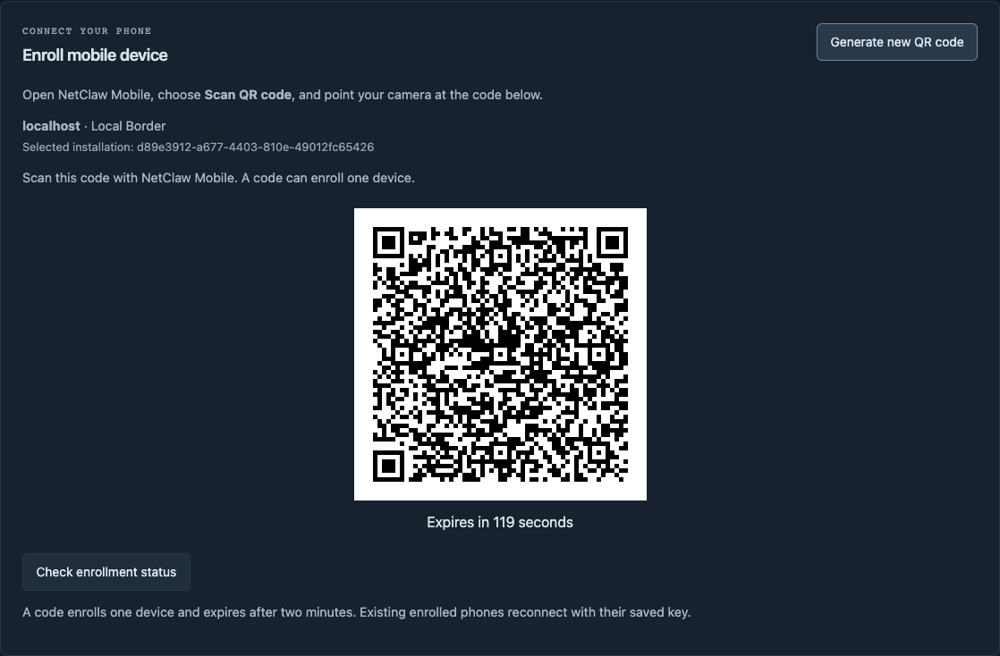

# Enroll NetClaw Mobile from the HUD or VS Code

Generate the enrollment QR where you already manage NetClaw. The HUD and VS Code
call the same enrollment service; you no longer need to find a CLI command before
connecting your phone.

Use a compatible Border with the enrollment backend from source **1.18.6**, the
**1.6.1** VS Code extension if enrolling from the editor, and Mobile **1.0.4** for
the updated binding and recovery flow. Component distribution status is recorded
in the [release evidence](../specs/175-cloud-mobile-enrollment/release-verification.md).
The phone must be able to reach the configured Border over trusted WSS.

1. In the **HUD**, open **Mobile**, then select **Generate QR code**. In **VS Code**,
   select your installation and open **Mobile & edge → Generate QR code**.
2. Open NetClaw Mobile and choose **Scan Border QR Code**.
3. Scan the displayed code and check the connected installation. The issuing
   interface shows when enrollment is consumed and clears the QR.

The QR is a short-lived, single-use credential. Generate it when the phone is
ready. If it expires, explicitly replace it. If an enrollment reply is interrupted,
resume the pending enrollment with the same device identity; do not keep making
new identities or repeatedly issuing codes. After success, the phone retains its
key and reconnects without another QR.

*Actual HUD capture from an isolated local fixture. This throwaway QR was allowed
to expire and verified unusable before publication. It cannot enroll a device.*

The existing CLI remains available for advanced workflows. The UI makes its
enrollment capability discoverable and handles the transient code, status and
replacement in one place. Updating the extension or phone alone does not upgrade
an existing Border backend.

Actual qualification covers four HUD/editor enrollment paths on macOS and an
iPhone simulator, retained-key reconnect, scoped refusals, a successful signed
read, durable acknowledgment, and cold/background recovery with no repeated
execution. The simulator uses a test-only native image decoder and Keychain
identity; this does not qualify physical camera or Secure Enclave hardware.
[Detailed evidence and limits](../specs/175-cloud-mobile-enrollment/verification.md).
