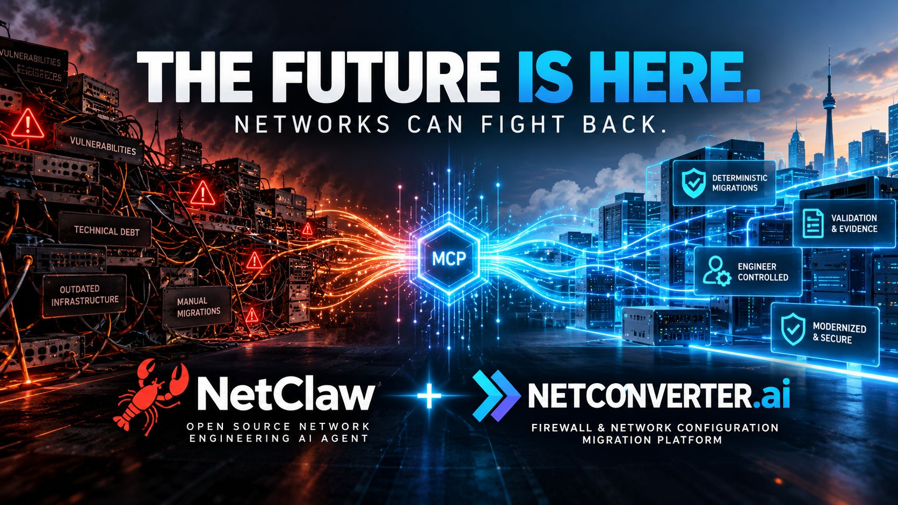

# NetConverter and NetClaw: turning the migration vision into working evidence

*Draft for Marcin Zgola, technical lead and co-founder, and Steven Robb, CEO and co-founder of NetConverter.ai. From John Capobianco. November 1, 2026.*

Marcin and Steven,

Our conversation has become working software. NetClaw can now use NetConverter through a guarded MCP integration, carry a real conversion result into an authorized virtual-router rehearsal, and return evidence about what the candidate actually did. We have also built a fresh Border with one dedicated NetConverter member and demonstrated real agent-to-agent delegation into your service.

That gives us something concrete to put beside the vision in [Steven’s post](https://www.linkedin.com/posts/swrobb_agenticai-networkautomation-cybersecurity-share-7521248492401590272-HMec/): a tested reference workflow connecting migration, validation and engineering accountability.

*Concept artwork shared with Steven’s post. It illustrates the ambition; the results below describe the specific work we tested.*

NetConverter brings the migration expertise: supported configuration conversion, validation, optimization and job evidence. Its [official MCP connection model](https://netconverter.ai/mcp.html) gives an engineering assistant access to saved work and an explicit path for submitting selected files. NetClaw adds orchestration around that capability: collecting an authorized source artifact, coordinating specialist tools, preparing a lab, applying an approved candidate, observing the result and assembling the review package. Your engine supplies the conversion; NetClaw connects that result to the rest of the engineer’s work.

Marcin, the technical foundation is deliberately specific. NetClaw registers its own `netconverter-mcp` guard and uses the operator-installed [official Terminal client](https://github.com/valeronlabs/netconverter_terminals). The tested client was version 0.6.0. We discover capabilities from the real connection, preserve platform and device-class distinctions, and validate the requested operation against the returned schemas. In our account’s observed response, 75 operation paths qualified: 47 convert, 14 optimize and 14 validate. Nine read operations qualified, and seven additional paths remained unqualified. Those numbers describe discovered options, with two actual conversion jobs providing the reference evidence.

The reference started with a synthetic IOS-XE OSPF configuration. After explicit approval of that exact file, NetConverter produced Junos SET output. A separate exact-file approval then authorized submitting that returned artifact for the reverse conversion to IOS-XE. Both jobs retained their **needs review** findings. We kept the warnings and manual actions with the candidates rather than treating job completion as deployment approval.

We then used the actual reverse-converted IOS-XE result on a real IOS-XE 17.18.2 virtual target in Cisco Modeling Labs. The reviewed adaptation mapped one interface name to the interface exposed by the available image. NetClaw captured a genuine baseline, applied the candidate through its protected pyATS route and verified the target alongside an independent peer.

| Check | Observed result |
|---|---|
| OSPF adjacency | FULL on both routers |
| Reciprocal loopback routes | Present, metric 11 |
| Positive connectivity | 5/5 pings in each direction |
| Unadvertised destination | 0/3 pings in each direction, as expected |
| Management access | Preserved in separate management VRFs |

Batfish supplied another kind of evidence. It parsed the source, Junos and reverse IOS-XE snapshots and passed nine modeled traffic assertions. It also exposed a meaningful difference: the modeled route metric was 10 for the Junos candidate and 11 for IOS-XE. We retained that difference. No Junos image was available, so the live appliance result qualifies the IOS-XE round trip; the Junos artifact has conversion and modeled evidence. Firewall policy, NAT and physical hardware performance need their own reference cases.

The controls are central to the integration. Before a hosted submission, the engineer reviews the file, digest, size, account reference, destination, operation, direction and options. Approval is consumed for one submission attempt. A changed request requires new review, and a lost response remains an unknown outcome rather than permission to submit again. The selected file travels to NetConverter over HTTPS; the protected workflow keeps full configurations and report bodies in private artifacts instead of placing them in model-facing results. That is a defined workflow boundary, with other agent file access still governed separately.

We tested the separation of responsibilities as well. The Border owns routing tools. The NetConverter member owns its integration, account key and private workspace. A real Border agent delegated a request; a real member agent called the native guarded tool; authenticated capability evidence returned to the Border. The Border did not need the converter credential. The clean Mac installation passed all 26 installer effects. Review inputs were simulated at my explicit request; installation, services, enrollment, the rendered HUD and agent execution were real.

Steven, the commercial opportunity I see is the ability to make a migration decision easier to reach and easier to defend. A customer has to connect an old configuration, a proposed replacement, unresolved findings, application behavior and a change decision. Keeping those pieces connected could reduce repeated collection, translation and documentation work while giving engineering and security reviewers a clearer basis for approval.

That could support assessment services, migration projects and modernization programs in which NetConverter’s specialist capability becomes part of the customer’s normal operating workflow. We have a technical demonstration of that connection. We have not yet measured customer delivery-time savings, migration cost reduction or security outcomes. A joint pilot could measure engineer hours, time to a reviewable candidate, unresolved findings, test failures and rework across a defined migration class. Those measurements would give the business case substance.

The surrounding ecosystem makes the opportunity broader. NetBox, Nautobot or OpsMill Infrahub could contribute inventory and intended state. IP Fabric or Forward Networks could contribute observed-path context. CML, containerlab, EVE-NG and GNS3 offer different rehearsal environments when the necessary images and controls exist. Jev can provide advisory review, and NetClaw’s diagram, document and ticket skills can organize approved evidence. These are documented composition paths; this live reference exercised NetConverter, CML, pyATS, Batfish and native federation. Each additional connection needs its own qualification.

For our next joint engineering review, I would put three items on the table: a shared reference suite that checks warnings as carefully as successful outputs; stable capability, account-binding and unknown-outcome contracts; and a narrowly scoped customer pilot with agreed success measures. A supported firewall case with explicit policy and NAT assertions would be a useful extension of the routing reference, once its images and authorization are available.

Spec162 now has **44 of 44 scoped tasks complete**, with five implementation review loops and three additional live qualification loops. The integration is prepared for source 1.18.0 with extension 1.5.0; the release record tracks publication separately from the completed engineering evidence. The [verification record](../../specs/162-netconverterai/verification.md) preserves the successes, failed trials, fixes and remaining limits.

Thank you both for the conversation that started this work. We can now demonstrate a real conversion, a real governed rehearsal and a working specialist-agent integration. That is a strong foundation for showing engineers how NetConverter and NetClaw can help them move a modernization decision forward with evidence they can inspect.
