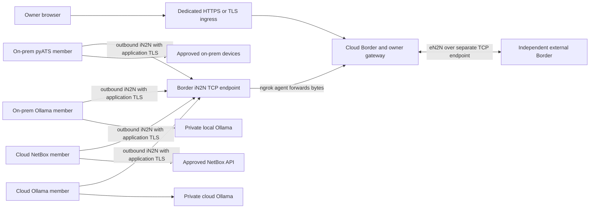

# Cloud Border and member architecture with an ngrok alternative

Technical handoff for an engineering agent. Prepared 2026-11-01.

The demonstrated architecture can plausibly be reproduced without Tailscale:
run a cloud Border, let cloud and on-premises members establish outbound
authenticated iN2N channels to it, and connect independent Borders through
eN2N/NCFED over ngrok TCP endpoints. Keep model selection and infrastructure
access at the assigned execution member. Keep approvals, budgets, inspection,
confinement and durable evidence at their existing enforcement boundaries.

This would reproduce the application outcomes after new qualification. It would
**change the network security model**: public ngrok service endpoints do not
reproduce a private tailnet, its machine identities or its packet-level grants.
An ngrok tunnel supplies connectivity; NCFED supplies application federation;
neither by itself supplies safe execution or distributed consensus.

The current [Thermidor constitution](../.specify/memory/constitution.md) requires
Tailscale and prohibits shipping or invoking ngrok. This handoff describes a
NetClaw-based alternative and the engineering needed for equivalent outcomes.
It does not amend that policy or add a Thermidor transport mode. Implementing
this inside Thermidor would first require an accepted constitutional change and
the normal specify → clarify → plan → tasks → analyze → implement sequence.

## What has actually been achieved

These are historical qualification results. The cloud trial had a scheduled
expiry of October 30, 2026; this document does not establish that its resources
are still running. Later milestone evidence supersedes older roadmap statements
that described the calculators or cloud NetBox member as future work.

| Area | Recorded outcome | Qualification boundary |
|---|---|---|
| Independent product | Thermidor packages, identities, configuration, certificates, secrets, state and audit run independently of NetClaw | Preserved source is not universal runtime or integration qualification |
| Cloud Border | GCP-hosted Border and authenticated browser HUD at a private HTTPS origin | One-owner bounded trial; the trial Border was control-only, without a local model runtime |
| On-premises execution | GCP Border dispatched an approved read to local Mac Docker pyATS; R1, R2, SW1 and SW2 returned parsed `show version`, IOS 17.15.1 | Read-only operation; device credentials and SSH access stayed at the member |
| Cloud execution | Separate NetBox member on the same GCP VM completed an approved browser-driven bounded device read | A separate installation/container role, not a separate VM failure domain |
| Paid cloud models | Both qualified read paths used guarded OpenClaw with `claude-haiku-4-5-20251001` | Specific installed provider/model and scoped tools; not arbitrary model compatibility |
| Ollama on premises | Linux ARM64 member on Mac Docker performed approved IPv4 subnet calculations | Ollama 0.40.11, Qwen3 0.6B Q4_K_M, CPU inference |
| Ollama in cloud | Linux AMD64 member on the GCP VM performed approved IPv6 subnet calculations | Same pinned runner/model; different measured resource/time profile |
| Combined calculator request | Browser dispatched separately approved local IPv4 and cloud IPv6 children; recorded completion was 28 and 150 seconds | Two approvals and two real model/tool workflows; no router configuration or subnet forwarding |
| External federation | Two independently administered tailnets supported Border-to-Border NCFED with bilateral consent, identity checks and recovery | This does not qualify an externally delegated Ollama or infrastructure execution workflow |
| HA foundation | Three Border/voter processes, two members and an external fixture exercised real etcd and authenticated channels in a local Docker lab | Spec005 qualification is still in progress; model/guard/effect providers in HA drills are synthetic fixtures |

Evidence: [private mesh milestone](thermidor-achievements.md),
[cloud trial](thermidor-cloud-border-trial.md),
[actual cloud-model browser executions](../specs/003-gcp-cloud-border/evidence.md),
[Ollama qualification](thermidor-ollama-members.md), and
[HA evidence and open tasks](../specs/005-border-ha-mesh/evidence.md).
In particular, standalone Ollama qualification must not be combined with HA
fixture results to claim HA Ollama support: that binding is currently refused.

## Roles and execution flow

A **Border** is the organization's coordination and policy boundary. It presents
the owner service, tracks enrolled members and approved capabilities, dispatches
authorized work, tracks results and exposes only approved external capabilities.
It need not run inference itself. Adding a Border model is a separate execution
profile, subject to the same controls as a member model.

A **member** is an independently identified execution installation with a scoped
runtime, model profile and tools. Its placement and inference provider are
independent choices. An on-premises member can call a cloud model; a cloud member
can run Ollama locally. Model locality describes where inference runs, not where
the Border or the infrastructure resides.

| Execution member | Inference location | Infrastructure/tool location |
|---|---|---|
| Local pyATS | Hosted Anthropic model through guarded admission | SSH from local member to approved lab devices |
| GCP NetBox | Hosted Anthropic model through guarded admission | NetBox API from cloud member's credential-owning broker |
| Local IPv4 calculator | Private Ollama on local member host | Bounded deterministic calculator tool |
| GCP IPv6 calculator | Private Ollama on cloud member host | Bounded deterministic calculator tool |

The verified pattern is:

1. The owner authenticates in the HUD and reviews the operation, member and model.
2. The service issues an exact, scoped approval and reserves bounded resources.
3. The Border sends work over the member's existing authenticated iN2N channel.
4. The member's runtime obtains admitted inference through its guard. The model
   proposes a tool call; it cannot mint authority or access integration secrets.
5. The broker validates the approved arguments and execution protections, then
   invokes the scoped MCP/tool. pyATS uses locally held SSH credentials; NetBox
   uses its broker-held token. Calculator results are independently validated.
6. Signed durable exports, acknowledgements, usage and result records support
   completion. Lost replies produce reconciliation work, not automatic replay.

“Control over on-premises members” therefore means authorized remote task
dispatch. It does not require cloud SSH access to routers, a routed cloud-to-LAN
network or public MCP servers. A local device VPN, where needed, remains a
member-to-device dependency. Local Ollama eliminates provider API charges for
those calculations, not compute costs or all possible data transfers: approved
results still travel to the Border and evidence collector.

## Proposed ngrok topology

Arrows into the iN2N endpoint show connection initiation; an established channel
carries requests and responses in both directions. ngrok's agent runs alongside
the Border and maintains an outbound tunnel to ngrok. Ordinary member clients
dial the resulting endpoint. They need neither their own ngrok agent nor an
inbound member listener for this design. [ngrok agent architecture](https://ngrok.com/docs/gateway/agent).

Start with distinct service registrations:

| Service | Proposed forwarding | Application requirement |
|---|---|---|
| Member iN2N | Reserved ngrok TCP address → Border TLS listener, conventionally local port 11790 | TLS verification, member enrollment/key proof, hub attestation and channel binding |
| External eN2N | Different reserved ngrok TCP address → Border NCFED listener, conventionally local port 1179 | Original NCFED preamble, TLS upgrade, verified peer identity, reciprocal consent and approved exports |
| Owner HUD/API | Separate reviewed HTTPS ingress, or TLS passthrough to the HTTPS gateway | Existing application authentication, cookie/session/revocation rules, CSRF, origin validation and approvals |
| Local models/tools | No ngrok endpoint | Ollama and broker/MCP access remain confined to their intended local callers |

One Border agent can manage multiple endpoints. The public assigned ports need
not equal the local service ports. Use reserved addresses and an explicit
endpoint registry for stable provisioning. ngrok documents raw TCP forwarding
and separately allocated static TCP addresses. [TCP endpoint documentation](https://ngrok.com/docs/gateway/endpoints/tcp).

There is an important firewall distinction: the **ngrok agent** uses outbound
TLS port 443, while a **member dialing a public TCP endpoint** connects to that
endpoint's assigned port. Do not promise that every member works through a
443-only egress policy. Check corporate proxy and TLS-inspection compatibility.
[ngrok port behavior](https://ngrok.com/faq).

Co-located members may use an explicitly configured local TLS path if separately
qualified. Keeping them on the same endpoint path initially gives clearer
transport qualification. Neither choice permits shared identities or a trust
shortcut because containers share a VM.

## Preserve the actual NCFED wire behavior

### External eN2N requires raw TCP for the original protocol

The pinned NetClaw implementation sends an NCFED identification preamble before
upgrading the same connection to TLS. The secured path requires TLS 1.3 and
proves dialer key possession at the application layer. Its binding implementation
hashes the listener certificate (`tls-server-end-point`); it is not a TLS
exporter despite some historical variable names and comments.

Consequently, use **ngrok TCP byte forwarding** for original eN2N. An HTTP
endpoint expects HTTP, and an SNI-routed TLS endpoint expects a TLS ClientHello
before it can route the stream. Neither is a direct substitute for a stream
whose first bytes are the NCFED preamble. This conclusion follows from the
[NetClaw TLS upgrade implementation](../netclaw/mcp-servers/protocol-mcp/bgp/federation/tls.py)
and ngrok's [TLS endpoint routing contract](https://ngrok.com/docs/gateway/endpoints/tls).

Preserve TLS termination inside the federation application. Edge termination
or termination in the ngrok agent would change what the application sees and
break the existing binding assumptions. Disable payload transformations and
PROXY-protocol injection unless a separately specified parser supports them.
Keep encryption enforcement enabled; never fall back to an unsecured NCFED mode
after a tunnel or certificate failure. The initial identification preamble and
connection metadata are not confidential merely because subsequent payloads are
encrypted. Audit the original shared-port BGP/NCFED dispatcher and refuse
unneeded protocol paths; public NCFED reachability must not grant routing control.

### Internal iN2N requires application TLS and enrollment

Remote iN2N begins with TLS, then an internal preamble and fresh challenge. The
member signs the challenge with its enrolled key, including a `tls-unique`
binding; the Border attests its hub identity. This is verified server TLS plus
application authentication, not a blanket claim that original iN2N uses TLS
client certificates. See [internal channel](../netclaw/mcp-servers/protocol-mcp/bgp/federation/internal_channel.py)
and [transport security](../netclaw/mcp-servers/protocol-mcp/bgp/federation/internal_security.py).

Require the TLS configuration even if the ngrok agent connects to a loopback
listener. Loopback is only the final local forwarding hop; the originating peer
is remote. A loopback cleartext exception would be unsafe here. The proposed
parity profile should preserve Thermidor's TLS 1.3 minimum rather than inherit
NetClaw's weaker minimum without review. Test the precise Python/OpenSSL binding
behavior and refuse missing or altered bindings.

Two implementation gaps need explicit work in a NetClaw-based build:

- **Launcher TLS wiring:** [in2n-member.py](../netclaw/scripts/in2n-member.py)
  calls `dial_border` without an SSL context. The
  [daemon dial loop](../netclaw/mcp-servers/protocol-mcp/bgp-daemon-v2.py)
  passes `internal_security.client_context(host)`. Correct and test the selected
  launcher; its documentation mentioning remote endpoints is insufficient.
- **Endpoint versus TLS identity:** original `dial_border` passes the connection
  hostname to `asyncio.open_connection` without a separate `server_hostname`.
  A reserved ngrok routing hostname need not equal the Border certificate name.
  Add an explicit verified TLS server-name field, as Thermidor's adopted path
  already does. Keep routing address, expected TLS identity and enrolled
  application identity distinct. Do not solve a name mismatch by disabling
  certificate checks.

A TLS passthrough endpoint on 443 is a possible later iN2N-specific option,
because iN2N starts with TLS. Its SNI routing name, application certificate and
trust configuration need deliberate alignment. It does not solve original
eN2N's preamble requirement. A new outer TLS/WebSocket carrier for eN2N would be
an additional protocol feature requiring its own qualification.

For external pinned trust, preprovision the approved peer identity through a
trusted operator process. Original first-contact TOFU behavior should not be
treated as equivalent to Thermidor's explicit enrollment. The ngrok account,
tunnel token and endpoint address never become peer execution credentials.

## What changes when Tailscale is removed

| Existing control | Required replacement or retained boundary |
|---|---|
| Tailnet machine identity and address-to-node lookup | Explicit endpoint inventory plus certificate/key-bound application identity; never identify a remote member by the local ngrok proxy address |
| Tailnet grants and directed reachability proofs | Host/container isolation, service-specific exposure, reviewed edge/source restrictions where applicable, and a new measured connectivity/admission policy |
| Private-only owner origin | An explicitly approved ingress/access design; public reachability changes exposure even when login remains mandatory |
| Member/peer enrollment and NCFED consent | Retain independently of ngrok account access or TCP connectivity |
| Tailscale withdrawal tests | Tunnel/endpoint revocation, policy withdrawal, certificate/member revocation, agent outage and recovery tests |
| DNS, endpoint lifecycle and key expiry | Stable endpoint ownership, verified certificate lifecycle, tunnel-token revocation and controlled endpoint changes |
| Model inspection, exact tool approvals, budgets and confinement | Retain at the model/effect boundary; do not move authority into the tunnel |
| Chained audit, signed export acknowledgements and recovery | Preserve independently durable records and refusal when required acknowledgements are unavailable |

Some network assertions cannot be carried over verbatim. An Internet observer
may establish a TCP connection to a public ngrok endpoint and still be rejected
by application authentication. That is different from the original packet-level
denial. If packet-level exclusion is required, specify and verify suitable
ingress restrictions; a successful application rejection does not satisfy it.

The existing Thermidor code deliberately depends on Tailscale observations:
[config](../src/thermidor/config.py), [service](../src/thermidor/service.py),
[policy](../src/thermidor/policy.py), [runtime](../src/thermidor/runtime.py), and
[network renewal](../src/thermidor/network_renewal.py).
Putting ngrok in front of the current service will encounter node-identity,
listener and evidence-admission checks. Deleting those checks would lose the
safety property they enforce. Define a replacement transport contract and
versioned evidence profile before changing implementation.

Also inventory paths outside federation. The cloud trial's off-cloud signed
collector uses bounded installer-owned IAP/SSH pipes, with its signing key on
the Mac; local collectors use owned export storage. This path does not become
an NCFED feature merely by changing mesh transport. It can remain an independent
GCP administration/evidence path in a no-Tailscale design. A requirement that
*all* traffic use ngrok needs an additional collector transport design retaining
ownership checks, durable acknowledgements and deadlines.
See [remote exports](../src/thermidor/remote_export.py) and
[cloud collector operation](../labs/cloud/README.md).

## Multi-region and multi-cloud direction

The recorded [global hybrid HA program](../specs/005-border-ha-mesh/program.md)
has this sequence:

1. Finish the isolated HA authority foundation.
2. Qualify three GCP regions: Americas, Europe and Asia-Pacific.
3. Add the authorized global operations globe.
4. Add Azure, then qualify three Azure regions.
5. Add an on-premises Mac Border: seven Borders total.
6. Add AWS, then qualify three AWS regions: ten Borders total.
7. Immediately follow with the dedicated users, SSO, OAuth and RBAC feature.

Only the first slice currently has an active numbered feature. Future cloud
stages need their own placement, runtime, cost, data-destination and failure
qualification. The current owner authentication mechanism remains the intended
mechanism through the cloud program. No regional/provider SLA is established.

An ngrok variant can retain that application layout: each eligible Border has
explicit authenticated service endpoints, and each member maintains its own
outbound attachment to every eligible Border in its cluster. At seven Borders
there are 21 logical Border pairs and M×7 member attachments; at ten there are
45 Border pairs and M×10 attachments. These counts describe relationships, not
necessarily endpoint count or number of consensus voters.

Keep three distinct relationships:

- **iN2N:** an enrolled member and its own authorized Border/cluster.
- **Internal HA Border links:** cluster membership, authority and bounded control
  state; these require the HA contract, not ordinary external peer consent.
- **eN2N:** an independent organization's Border, with bilateral consent,
  restricted capability exposure and separate budgets. It gains no vote or
  access to internal members or cluster state.

Original NetClaw eN2N peering does not elect one safe execution leader. The HA
foundation uses etcd majority transactions, one execution authority, exact
approvals, fresh one-use admission claims, member-enforced fencing and durable
unknown-outcome handling. No quorum means no new protected execution. Region or
provider failure must never trigger replay of an uncertain infrastructure action.

**The quorum network is a separate design obligation.** The current HA lab uses
separate etcd client and peer paths on 2379/2380 in addition to its application
channel. A no-Tailscale deployment must explicitly carry and protect those paths
too. Possible ngrok TCP forwarding for them needs strict TLS/mTLS, RBAC, stable
advertised endpoints, caller restrictions and partition/latency qualification.
Member and external-peer identities receive no etcd access. Do not expose an
unrestricted database endpoint or assume NCFED carries Raft automatically.

Use distinct node endpoints for individually authenticated member and cluster
attachments. ngrok pooling can distribute ingress connections across replicas,
but application routing must still reach the valid leader or an authenticated
forwarding frontend. Pool membership cannot confer execution authority, preserve
a broken stream's state or make retries safe. [ngrok endpoint pooling](https://ngrok.com/docs/gateway/endpoints/endpoint-pooling).

Design voting placement independently of Border count. Three voters require two
for a majority. A two-provider placement cannot survive loss of either provider
if one contains that majority. Later GCP/Azure/AWS placement may provide three
independent voting domains, subject to measured WAN behavior. Mac sleep,
residential connectivity, ngrok service/account availability, DNS, model-provider
availability and the local device VPN remain separate shared dependencies.

## Engineering sequence for the receiving agent

Treat this as a proposal for new work, not permission to change live deployments.
First choose the product scope: a separate NetClaw-derived implementation, or a
reviewed Thermidor constitutional amendment. Preserve fresh installation and
separate product/state/credential boundaries; do not import existing NetClaw homes.

The recommended source strategy is to reuse the pinned NetClaw federation
protocol and ngrok TCP approach, then deliberately adopt the reviewed Thermidor
execution controls required by the parity matrix. Do not assume those later
Thermidor controls already exist in the original NetClaw build. Preserve notices
and dependencies, and package the chosen result independently.

For each feature follow specify → clarify → plan → tasks → analyze → implement:

1. **Define parity:** select the exact cloud/on-prem read and calculator outcomes,
   the required isolation level and the retained product capability portfolio.
   Record endpoint trust, allowed data destinations and 443-only egress constraints.
2. **Specify the transport:** separate endpoint address from identity; define
   listener exposure, forced application TLS, consent/enrollment, revocation,
   policy evidence, stable addresses and collector/admin paths. Fix launcher and
   TLS-name gaps through analyzed tasks.
3. **Qualify one Border and members:** reproduce local pyATS, cloud NetBox, local
   Ollama IPv4 and cloud Ollama IPv6 through the browser. Add a distinct external
   Border to reproduce federation consent and boundary tests.
4. **Qualify recovery:** tunnel failure, listener failure, member/provider outage,
   restart, token/certificate revocation, lost replies and signed-result recovery.
5. **Qualify HA separately:** port the complete authority/fencing/state contract
   and protected quorum transport; first use fixtures, then qualify real guarded
   model/tool runtimes. Do not skip from fixture HA to production claims.
6. **Expand geographically:** execute the cloud program with measured capacity,
   data placement, costs, lifecycle and failure-domain evidence at each stage.

No ngrok pricing or entitlement is assumed. Verify the selected account's TCP,
reserved-address, policy, endpoint and usage limits before deployment costing.
Cloud spend and live deployment remain separate from this documentation task.

## Acceptance evidence for an equivalent outcome

| Test group | Required evidence |
|---|---|
| Real workloads | Approved browser dispatch to all four member profiles; real model turns/tool calls; correct parsed device/API results and independently checked arithmetic |
| Infrastructure scope | No cloud-to-device SSH route needed; unknown devices, disallowed commands, altered arguments and unapproved writes refused |
| Model isolation | Provider keys only at guards; Ollama accessible only to its approved guard; direct agent/model bypass refused; real usage and resource accounting |
| Federation identity | Wrong TLS name/CA/pin, altered binding, forged possession, expired/replayed enrollment, revoked member and wrong-organization access refused |
| External boundary | Missing/one-sided/revoked consent refused; external peers cannot directly invoke members, enumerate prohibited internal data or gain cluster authority |
| Network exposure | Active positive controls plus tests from unenrolled/external namespaces; document TCP reachability separately from authenticated admission; no member/model/tool listeners unintentionally exposed |
| Tunnel lifecycle | Stable endpoint restart/reconnect, token revocation, endpoint replacement, tunnel outage and required fail-closed behavior without insecure fallback |
| Durable outcomes | Signed durable acknowledgements before protected consumption/effects where required; lost ACK, cancellation, duplicate submission and uncertain outcomes reconciled without replay |
| HA | Leader loss, minority/three-way/asymmetric partitions, stale leaders, quorum loss, clock uncertainty, full restart, retired-node return and fenced restore |
| Release portfolio | Preserve skills/MCPs, gateway, HUD, Zoom, Mobile, VS Code and supported runtime/federation source paths; record qualified/retained/unqualified status per platform and transport |

Carry forward historical evidence as a baseline, not as proof that ngrok passed
these tests. In particular, the original lab's 240 connectivity checks and 160
observer checks describe a Tailscale policy; new endpoints require their own
positive, negative and recovery evidence.

## Source baseline and navigation

The inspected NetClaw checkout and Thermidor's provenance record pin upstream
commit `89627477fb470cd7c293e33e192c5983819d45d4` from
`https://github.com/automateyournetwork/netclaw` (Apache-2.0).
Thermidor HEAD at inspection was
`ebc91b3621bc874541a115e6d544f3a1fb267f6f`; the working tree also contained
uncommitted Spec005 HA work. That HEAD alone does not identify the HA snapshot
described here. A later implementation plan must pin its actual adopted bytes.

| Concern | Starting points |
|---|---|
| Original ngrok transport | [NetClaw CLI](../netclaw/scripts/netclaw), [peering setup](../netclaw/scripts/peering-setup.sh) |
| NCFED handshake, consent and dispatch | [federation service](../netclaw/mcp-servers/protocol-mcp/bgp/federation/service.py), [TLS](../netclaw/mcp-servers/protocol-mcp/bgp/federation/tls.py), [channel framing](../netclaw/mcp-servers/protocol-mcp/bgp/federation/channel.py) |
| Member transport and launcher | [internal channel](../netclaw/mcp-servers/protocol-mcp/bgp/federation/internal_channel.py), [internal security](../netclaw/mcp-servers/protocol-mcp/bgp/federation/internal_security.py), [launcher](../netclaw/scripts/in2n-member.py), [remote TLS tests](../netclaw/tests/n2n/test_internal_tls_security.py) |
| Thermidor execution parity | [broker](../src/thermidor/operation_broker.py), [model admission](../src/thermidor/model_admission.py), [approved execution](../src/thermidor/approved_execution.py), [calculator execution](../src/thermidor/calculator_execution.py) |
| HA and future deployment | [HA support guide](thermidor-border-ha.md), [program](../specs/005-border-ha-mesh/program.md), [evidence](../specs/005-border-ha-mesh/evidence.md), [remaining tasks](../specs/005-border-ha-mesh/tasks.md) |
| Provenance and independent packaging | [source inventory](../config/source-provenance.json), [notices](../NOTICE.md), [release builder](../scripts/build-release.py) |

The receiving agent's first deliverable should be a specification and gap
analysis for this alternative, with the wire compatibility and isolation
decisions resolved before implementation. The target is the same approved
cloud-to-member outcomes and safety invariants, with explicit evidence for the
new transport and honest limits on network equivalence.
