# Preferred reference: IOS-XE to Junos, OSPF to OSPF

Owner requested this concrete conversion for live testing, documentation and the community article on 2026-10-30. It is the preferred reference, conditional on actual account/path support and a compatible licensed Junos router image.

An [authored synthetic source fixture](examples/README.md) is ready for account
capability qualification and exact-file review. On 2026-10-31 the owner approved
its exact hosted submission; real IOS-XE → Junos SET conversion and a separately
approved reverse conversion completed, both needs review. The reverse candidate
subsequently passed the real IOS-XE rehearsal below. The source fixture remains
authored input, not a collection from the owner's routers.

The [current vendor matrix](https://netconverter.ai/docs/supported-vendors.html) lists IOS-XE↔JunOS router translation including OSPF and BGP. Router results remain NEEDS REVIEW. It explicitly excludes EIGRP translation to JunOS; EIGRP→OSPF is an opt-in redesign. The public matrix is eligibility research, not proof that this account or a particular configuration is supported.

## Actual demonstration sequence

1. Inspect current router identity and protocol state. The owner’s existing four devices remain untouched while eligibility is established. If no OSPF source exists, provision a separate authorized source twin with documented synthetic addressing and OSPF configuration; never invent a running protocol from the inventory.
2. Use an isolated source router and a stable peer to establish area 0 adjacency, loopback advertisements, selected interface costs and an agreed assertion matrix. Record real baseline and private source configuration artifact, version and hashes.
3. Discover `cisco_ios_xe_router`→an offered Junos router format on the actual selected account. Prepare the exact source file with the NetClaw guard. The owner reviews file/hash/account/destination/options and approves that one hosted transfer.
4. Submit once through NetConverter Terminal MCP. Save the actual job identity, source/candidate hashes, evidence, warnings and manual actions. Preserve NEEDS REVIEW even if generated syntax checks pass. A simulated or hand-authored Junos candidate cannot count as a NetConverter result.
5. Create and boot a run-owned Junos router on the verified compatible platform. Record exact image/version/template/digest, entitlement, capacity, interfaces and isolated network attachment. A Junos switch or SRX image does not automatically qualify as a supported router target.
6. Review interface/management remapping as a separate local derivative artifact linked to the original downloaded candidate. Record every adaptation; retain the original NetConverter output. Changes to routing intent require new review, not silent edits to make tests pass.
7. Apply through a qualified existing platform configuration route with real baseline, approval, exact candidate binding, commit/readback and runtime permission checks. The pyATS artifact route must prove Junos commit semantics before qualification; an IOS-only apply test is insufficient. No direct SSH/console workaround after a denied configuration tool.
8. Run the same positive and negative assertions on source and target. Save actual outputs privately and publish only approved synthetic/sanitized evidence. Retain target resources for review.

## Assertion matrix

| Assertion | Evidence required | Failure meaning |
|---|---|---|
| Router identity/version | Actual show command and image provenance | Wrong target invalidates the run |
| OSPF neighbor FULL | Both sides, expected router IDs/area/network type | Adjacency failure, not a passing conversion |
| Expected loopback route | Prefix, protocol, next hop and metric where comparable | Missing or changed routing behavior |
| Positive traffic | Repeated probes between agreed test endpoints | Forwarding not established |
| Negative control | Deliberately unadvertised synthetic prefix; absence of route and unsuccessful probe | Unexpected reachability or invalid test setup |
| Passive-interface behavior | No adjacency on an explicitly passive segment | Intent changed or check unavailable |
| Management preservation | Post-apply authenticated readback | Recovery needed before further testing |
| Convergence (optional) | Explicitly authorized link event, timestamps and restored adjacency | Report measured bound only; no ASIC equivalence |

NAT, firewall-policy equivalence, throughput and physical hardware performance are outside this routing demonstration unless separately configured and actually tested. A failed negative control must fail the corresponding assertion. Batfish can add scoped static evidence; it cannot substitute for boot, commit or traffic.

## Article evidence rule

Use the [review package template](review-package-template.md) for the proposed
isolated topology, test matrix and local change draft. It contains synthetic
addresses and no fabricated observed topology or results.

The article should show a simple source→NetConverter→Junos-target diagram, actual observed steps and outcomes, warnings/manual adaptations, exact test coverage and retained resources. Publish a conversion claim only after the real service produces the candidate; publish a working migration claim only after the actual target accepts it and the stated checks run. Pending prerequisites remain pending in drafts. No publication or external communication is implied by preparing the article.

## Observed IOS-XE round-trip rehearsal — 2026-11-01

The real account converted the synthetic IOS-XE fixture to Junos SET, then converted
that returned artifact back to IOS-XE under a separate exact-file approval. No Junos
image was available. The returned IOS-XE candidate was adapted only from
`GigabitEthernet0/0/1` to `Ethernet0/2` and applied through the real protected route
to an IOS-XE 17.18.2 target that started with management configuration only.

```mermaid
flowchart LR
    Source["Synthetic IOS-XE OSPF source"] -->|Approved upload| Junos["NetConverter Junos SET artifact"]
    Junos -->|Separately approved reverse upload| Reverse["NetConverter IOS-XE artifact"]
    Reverse -->|Reviewed interface mapping and API apply grant| Target["Actual IOS-XE target: Lo0 192.0.2.1"]
    Target <-->|"198.51.100.0/30: OSPF FULL"| Peer["Actual IOS-XE peer: Lo0 192.0.2.2"]
    Target --> Evidence["5/5 positive, 0/3 negative, metric 11, MGMT preserved"]
    Peer --> Evidence
```

This diagram contains only synthetic addresses and the observed test relationship.
Management addresses and topology remain private. Both routers passed independent
readbacks. The source/Junos/reverse Batfish comparison remains a separate modeled
result, including Junos metric 10 versus IOS-XE 11. No physical hardware equivalence,
executed rollback or Junos appliance behavior is inferred. See
[verification](verification.md#clean-protected-repeat--passed) for artifact hashes,
the clean repeat and the earlier control failure retained in the evidence.
