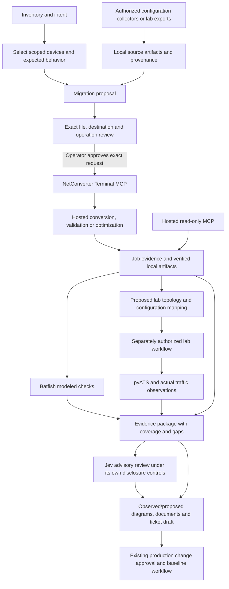

# Spec162 research evidence

Research date: 2026-10-30. This is a source/documentation investigation, not live account, conversion or lab qualification. Scope decisions remain pending in spec.md.

## Upstream identity and provenance

- Supplied archive: repository-root `netconverter.skill`; SHA-256 `47aa7666fb9e3dcfc5a8961818189b873cf28e6d9f6a283968b0d48cde5009dd`. Archive contains `netconverter/SKILL.md` and its parent directory. Preserve the supplied source/provenance during adaptation; no Terminal implementation is part of this archive.
- Official [MCP guide](https://netconverter.ai/mcp.html) links the [Terminal repository](https://github.com/valeronlabs/netconverter_terminals). Read-only checkout: commit `ef28f5613a5f014dca7e8b2e38b8219cb461559f`, inspected outside NetClaw at `/tmp/netclaw-spec162-upstream`.
- [Package metadata](https://pypi.org/pypi/netconverter-cli/json): published `netconverter-cli==0.5.0`, Python >=3.12. Wheel SHA-256 `f5a8057756507fbaf76ca76ccd99f47e03942b6abe3051d0eb77c93d7d97e380`; sdist SHA-256 `9945820caede4c814e8c08bc32de9cbd0be853a7e85ad7de5c598cb1ae3a24b2`. Metadata observed, package not installed or executed.
- [Terminal license](https://github.com/valeronlabs/netconverter_terminals/blob/ef28f5613a5f014dca7e8b2e38b8219cb461559f/LICENSE) covers 0.4.4 onward, prohibits bundling/redistribution and modification, and requires a valid account. Integration must reference an operator-installed official client or obtain it directly from the official distribution within allowed use; do not vendor its code or automate license acceptance. This records upstream terms, not a legal opinion.

## Connection and operation findings

The website documents hosted MCP at `https://api.netconverter.ai/mcp/v1/` for reading saved work and a local Terminal bridge for submitting selected files. Hosted access needs account enablement. Local file handling still sends the selected configuration to the hosted API. Native OAuth is documented; API-key fallback exists. [Connection documentation](https://netconverter.ai/mcp.html).

The current Terminal README describes v0.5.0, capability-driven menus and existing-account authentication. Its OpenClaw gateway host must own the executable, workspace and credentials. The installer should configure only the selected NetClaw installation and avoid upstream `connect --all`, which would touch unrelated assistants. [Pinned README](https://github.com/valeronlabs/netconverter_terminals/blob/ef28f5613a5f014dca7e8b2e38b8219cb461559f/README.md), [OpenClaw instructions](https://github.com/valeronlabs/netconverter_terminals/blob/ef28f5613a5f014dca7e8b2e38b8219cb461559f/docs/connect/openclaw.md).

Source inspection found five base local tools: `submit_file`, `job_status`, `wait_for_job`, `account`, `download`. The remote allowlist has 33 names, making 38 a source-level maximum for ordinary mode, not an advertised installed count. Actual exposure depends on account, server and privacy mode. The newer mapping family includes `apply_mapping_answers`, so the word “read-only” must not be blindly applied to every future/available tool. Submission is non-idempotent at the MCP-call boundary; each call generates a fresh request key. Native upload elicitation is conditional on client support. A timeout cannot justify another submission. [Pinned MCP implementation](https://github.com/valeronlabs/netconverter_terminals/blob/ef28f5613a5f014dca7e8b2e38b8219cb461559f/src/netconverter_cli/mcp_server.py).

The bridge's `account` projection provides job types, credential source and exposure metadata, but does not expose the full source/target catalog or a stable tenant identifier. Therefore a plan cannot assume that calling `account` alone proves direction support or identity equivalence between hosted and local bindings. Additional supported discovery or an explicit operator binding is needed. Source inspection also found a custom upstream JSON-RPC implementation. NetClaw must not copy it; any new NetClaw-owned MCP surface uses the official SDK as required by the constitution.

The privacy default is masked. Raising folder exposure requires terminal confirmation, and flags cannot independently raise it. The bridge's masking does not restrict other agent file tools. Raw configuration access, private model review and transfer to another hosted service each require their own applicable scope. [Privacy contract](https://github.com/valeronlabs/netconverter_terminals/blob/ef28f5613a5f014dca7e8b2e38b8219cb461559f/docs/PRIVACY.md).

The guided draft mode is a development preview, initially ASA → Palo Alto SET. It requires server support and has distinct revision, approval and idempotency semantics. Ordinary MCP connection does not enable it. Missing support must remain unavailable rather than trigger legacy submission. [Guided contract](https://github.com/valeronlabs/netconverter_terminals/blob/ef28f5613a5f014dca7e8b2e38b8219cb461559f/docs/guided-workflows.md).

Guided preparation itself uploads the source; YAML import also transfers a document. Exact-file disclosure approval therefore belongs before these transfers, independently of later conversion execution approval. A later human-bound execution receipt does not retroactively approve the initial disclosure. [Draft service implementation](https://github.com/valeronlabs/netconverter_terminals/blob/ef28f5613a5f014dca7e8b2e38b8219cb461559f/src/netconverter_cli/drafts.py).

## Capability discrepancies to correct in the supplied skill

The official vendor page distinguishes platform roles and device classes: ASA/ArubaOS are source-only; Check Point requires a handoff bundle; FMC output is a file/import package and FMC input is a preview per-device handoff. SCM is not currently a hosted target. Routers support IOS-XE ↔ JunOS; switch paths are separate, with Aruba CX between IOS-XE and JunOS and no direct IOS-XE-switch ↔ JunOS-switch claim. Router/switch results retain NEEDS REVIEW. FRR is not listed as a native converter path. These findings supersede stale blanket target lists, but runtime capabilities must still qualify each account. [Supported platforms](https://netconverter.ai/docs/supported-vendors.html).

The user-supplied skill lists 35 tools and SCM as a target; the inspected source adds mapping operations and privacy-dependent exposure. Preserve evidence-first review and path-based submission, replace static completeness claims, and document tool-presence checks without assuming all tools are always exposed.

## Composition research and proposed handoffs

The following are proposed NetClaw compositions inferred from existing local skill contracts. They are not evidence that a live end-to-end scenario ran.

Collector compatibility must include a local artifact output path. Some existing collection tools return raw configuration text to the model; those are not automatically suitable for this workflow's source-configuration boundary. Use an existing verified file-producing operation or an operator-staged artifact and mark unsupported handoffs explicitly.

| Stage | Existing integration/skill | Handoff and boundary |
|---|---|---|
| Select estate and enrich intent | NetBox, Nautobot, OpsMill/Infrahub, ServiceNow CMDB, Catalyst Center | Device identity, ownership, site, addresses and intended relationships; inventory is not a running configuration |
| Collect supported configurations | `pyats-network`, `pyats-asa-firewall`, `junos-network`, `fortigate-ops`, `aruba-cx-config`, `paloalto-panorama`, `fmc-firewall-ops`, `checkpoint`, `fortimanager-ops` | Authorized per-device artifact with format/time/hash; management exports must meet NetConverter's supported handoff format |
| Add observed paths and policy | `ipfabric`, `forward`, `fwrule-analyzer`, routing/security skills | Snapshot-bound evidence and expected flows; verify actual config-export support before claiming these produce source files |
| Convert / validate / optimize | New `netconverter` skill and upstream MCP | Supported operation and direction, exact artifact, reviewed options, account-bound job and verified outputs |
| Review evidence and change proposal | `jev-evidence-review`, `jev-change-review`, `jev-specialist-advice` | Explicitly enabled bounded advice, metadata and appropriate privacy scope; probability cannot approve deployment |
| Static differential analysis | `batfish-config-analysis` | Baseline/candidate snapshots, parse warnings, reachability/ACL comparisons; uploading to remote Batfish is a separate transfer |
| Prepare lab topology | CML topology/lifecycle skills; `clab-lab-management`; EVE-NG lab/config/node skills; GNS3 project/node/link skills | Image/node definitions and explicit interface mapping; platform support does not establish vendor translation support |
| Observe actual lab behavior | `pyats-dynamic-test`, `pyats-health-check`, `pyats-routing`, `pyats-security`, `pyats-parallel-ops`; protocol/packet tools where available | Spec160 dynamic testbed candidates validated before activation; expected/observed state, actual flow tests, cleanup scope |
| Explain visually | `drawio-diagram`, `uml-diagram`, `markmap-viz`, `threejs-network-viz`, `canvas-network-viz`, `comfyui-topology-viz` | Separate observed and proposed topology, attach evidence IDs; synthetic rendering cannot establish network state |
| Document and control change | `network-report-documents`, `document-generation`, `servicenow-change-workflow`, `gait-session-tracking` | Draft evidence package and rollback/test plan, explicit external-write authorization, approved production CR before application |

## TO and FROM digital twins

Topology packaging, network OS translation and functional validation are separate tasks. A lab-exported IOS-XE configuration might qualify as NetConverter input; an FRR configuration does not become IOS-XE because it came from CML or containerlab. A diagram is neither an importable lab nor a tested twin.

| Platform | FROM lab | TO lab | Qualification needed |
|---|---|---|---|
| CML | Extract available per-node configurations, retain node/image identity | Bind supported target config to node definitions and topology YAML | Extraction support and fidelity vary; running versus startup state must be checked. [Cisco extraction guide](https://developer.cisco.com/docs/modeling-labs/extracting-configurations/) |
| containerlab | Collect actual running config with supported kind save/export behavior | Topology with kind/image, startup config and links | Startup behavior and persistent lab-directory configs can differ; actual boot needs verification. [Configuration management](https://containerlab.dev/manual/config-mgmt/) |
| EVE-NG | Export node configurations into the lab artifact | Import/review startup configuration and node/image mapping using existing EVE skills | Discover installed edition/API behavior and export success. [EVE API](https://www.eve-ng.net/index.php/how-to-eve-ng-api/) |
| GNS3 | Export project and supported node config artifacts | Project/template mapping with licensed image references | Project import/export is not a universal device-config translator. [GNS3 API](https://api.gns3.net/en/latest/api/v2/controller/project.html) |
| FRR/router containers | Capture actual FRR config as its own format | An independent intent-based FRR candidate where requested, clearly separate from NetConverter translation | No native NetConverter FRR direction verified. Current containerlab documents an `frr` kind, startup config and save support; installed-version probing remains necessary. [FRR kind](https://containerlab.dev/manual/kinds/frr/) |

Validation must cover selected policy flows (including negative cases), NAT where represented, routes/VRFs and interface mappings. Batfish's [platform support](https://github.com/batfish/batfish) and parser findings constrain modeled results. Actual target acceptance and forwarding need suitable images/devices and observed tests. Round-trip success must compare behavior and retained findings, not merely text similarity.

## Research-driven acceptance risks

1. Existing metadata calls may not establish the full capability/tenant binding required by the desired UX.
2. Native upload confirmation is not universally available; the selected submission policy needs an enforceable integration path, not only prose.
3. Ordinary and guided preview modes have different tools and recovery behavior.
4. Restrictive licensing prevents shipping the Terminal inside NetClaw or the VSIX.
5. Public evidence and local fixtures cannot qualify live accounts, image compatibility, Windows/WSL or every migration pair.

## Session evidence

- Created and checked out GAIT session `spec162-netconverterai-20261030`; initial record `c347698e`.
- Startup `pyats_list_devices` attempted: owner pyATS HTTP runtime missing. No device-state claim and no owner runtime installation performed.
- No NetConverter credentials read, license accepted, account queried, job submitted, lab changed or external ticket created during this research.
- Local prerequisite inspection found no `netconverter` executable on PATH and no NetConverter variable names in the repository `.env`. Only variable names were checked; no values or upstream credential-store/license state were read. This does not prove that no account exists elsewhere.
- Owner clarified both product decisions: exact-file approval and actual virtual-target creation/testing wherever feasible. Five implementation iterations will use a fixed review prompt and retain findings/fixes/tests in their own evidence file; Claude-specific stop hooks will not be represented as having run in Codex.
- Follow-up read-only feasibility inspection: this host is ARM64; Docker client exists but the selected `desktop-linux` context cannot reach its socket. No image/capacity inventory was obtained. `containerlab`, `podman`, `virl` and `netconverter` are absent from PATH; no relevant lab/NetConverter variable names were found in the repository `.env`. The connected NetClaw inventory request failed with MCP internal error and no job identifier. None of these observations proves remote labs or images are absent. Owner was asked for a lab host/image inventory while design continues.

## Phase 0 decisions after parallel research

The Spec Kit planning skill explicitly required research-agent dispatch. Transport, installer and lab researchers performed read-only source inspection; their findings informed the following decisions.

| Decision | Rationale | Alternative considered |
|---|---|---|
| One guarded component/registration | Raw Terminal registration would expose an independent submission route | Register raw local and hosted servers together: rejected for route/account ambiguity and approval bypass |
| Installation-specific managed API-key profile | Upstream automatic MCP auth can prefer Clerk; explicit key/destinations make the reviewed binding deterministic | Borrow existing keychain/OAuth automatically: rejected; document independent OAuth separately |
| Frozen snapshot inside selected workspace | Preserves byte identity and existing privacy policy, including a restrictive none setting | New unrelated temporary workspace: rejected because it could reset exposure policy |
| Operator grant before one durable submission attempt | Native upstream elicitation alone does not supply the complete reviewed binding and has an error-handling gap | Rely exclusively on prompt confirmation: rejected |
| Strict initial read profile and no guided/mapping mutations | Preview contracts and conversion-triggering mapping operations need separate approvals | Treat every upstream advertised tool as read-only: rejected |
| Existing configuration tool gains artifact input | Preserves its runtime policy identity and keeps config text out of model arguments | New unrestricted apply tool or generic MCP relay: rejected |
| API-issued candidate-bound one-use capability | An APPLY message or an on-disk phase field alone is not machine-verifiable exact-artifact authorization | Model-provided approval flag or arbitrary record path: rejected |
| Actual eligible vendor-appliance rehearsal | User explicitly requested virtual creation and testing | Artifact-only first release: superseded by owner clarification |
| Retain run-owned lab resources by default | Existing destructive-command policy does not authorize automatic destroy/wipe cleanup | Blanket teardown: rejected |
| Explicit Batfish parse/query status | Partial parsing and failed differential queries cannot establish equivalence | Treat overall PASS/empty diff as sufficient: rejected |

Installer findings: canonical catalog drives Bash and HUD env-map generation; explicit skill joins precede generation. Effect inventory hashes the installer file and function, and isolated-shell execution needs plan-steps dispatch. Both Python and TypeScript non-secret-plan scanners need the NetConverter key prefix. Current inventory before implementation is 110 components, 237 skills and 176 MCP integrations (124 registered +52 external); planned additions must be counted from actual delivered artifacts.

Lab findings: current CML tool names differ from some bundled examples; EVE template listing does not prove a disk image; GNS3 lifecycle/export metadata does not provide private config apply or a saved export; remote containerlab startup paths are server-local. pyATS requires the same persistent process for activated dynamic inventory and execution. Existing pyATS configuration APIs take inline data and can return/log config, so the private artifact extension and raw-log boundary are required. Hermes Local/Lab APPLY remains unavailable. Some provider “GAIT” decorators only log locally; call actual GAIT or the documented scoped local audit.

The three refinements found during cross-artifact analysis are recorded in analysis.md. All task coverage is accounted for; source and live execution remain unimplemented/unverified at this planning checkpoint.

## Actual upstream qualification update — 2026-10-31

The earlier 0.5.0 source research is historical. The owner supplied an enabled key;
actual qualification uses official Terminal 0.6.0, wheel SHA-256
`6b98c11f9d73a6eefb92af28a5bc4cc2ac055ee4a97fb3ea9bd30cd0ef5e5a38`.
The owner explicitly delegated license acceptance, then independently completed
native exact-file approvals for two synthetic conversions. See
[live iterations](live-iterations.md) for observed account paths, needs-review
results, candidate hashes and concrete remaining lab prerequisites.

Live catalogs qualify 47 convert plus 14 validate and 14 optimize combinations.
Palo Alto XML is explicitly text, so the previous blanket XML exclusion was
incorrect. Check Point's non-text handoff bundle and advanced guided/prescan
operations remain outside the managed submission profile. Junos router OSPF
knowledge lookup is supported/full; EIGRP lookup returns unknown and is not
permission to treat EIGRP→OSPF as an automatic protocol translation.

CML's own installed inventory distinguishes images from definitions, matching
[Cisco's documented distinction](https://developer.cisco.com/docs/modeling-labs/creating-a-new-node-definition/).
No Junos image exists in the observed host. Actual live resource and protected
runtime availability continue to gate appliance rehearsal.

Batfish now supplies native ARM64 images according to its
[official releases](https://github.com/batfish/batfish/releases). The analysis run
pins the observed official ARM64 image digest, keeps its API on loopback and
preserves the original candidate bytes. The declared older pybatfish client
imports pkg_resources, which [setuptools removed in 82](https://setuptools.pypa.io/en/latest/history.html#v82-0-0).
Its own warning recommends setuptools<81; actual isolated startup verified the
compatibility constraint. This does not upgrade the client or infer a device pass.
