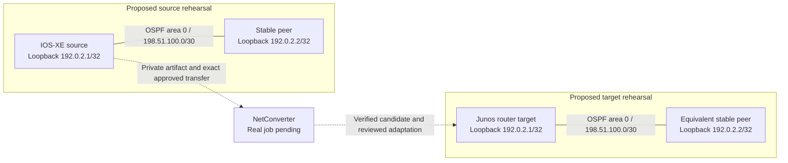

# IOS-XE to Junos OSPF review package — unexecuted template

**State:** proposed; no conversion job or virtual target run is represented here.
Replace each pending field with evidence from the actual run. Keep the completed
package private until its contents and destination are explicitly reviewed.

## Provenance and scope

| Item | Evidence to record | Current state |
|---|---|---|
| Source | Device identity/version, collection time, private artifact SHA-256 | Pending |
| Conversion | Account binding, offered router path, approved request digest, job ID | Account enablement pending |
| Candidate | Verified original download hash, format, warnings/manual actions | Pending |
| Adaptation | Separate interface/management changes, derivative hash and review | Pending |
| Target | Provider object IDs, exact licensed image/version/architecture and boot | Image/access qualification pending |
| Apply | Same-process inventory receipt, endpoint, baseline/rollback, actual API record | Pending |
| Outcome | Commit/readback, assertion evidence, failures and recovery | Not run |

## Observed topology

No source/target adjacency topology has been measured for this migration. Existing
lab identity reads are not topology, OSPF-state or migration-acceptance evidence.
Generate this view only from the scoped run's actual neighbor/interface records.

## Proposed isolated topology

Documentation addresses below are synthetic. Port names, management endpoints
and image compatibility require real discovery. Run source and target variants
in separate isolated networks; do not join the existing owner lab or production.

## Common assertion matrix

| Assertion | Expected result | Source | Target | Evidence/limit |
|---|---|---|---|---|
| Identity and image | Correct role, OS, image and management endpoint | Not run | Not run | Actual show output and image record |
| OSPF neighbors | FULL on both ends, area 0, reviewed IDs/network type | Not run | Not run | Neighbor output from both ends |
| Remote loopback route | Expected prefix/protocol/next hop | Not run | Not run | Route output; metrics compared with explicit semantics |
| Positive forwarding | Repeated loopback-to-loopback probes succeed | Not run | Not run | Timestamped probe results |
| Negative control | No route/probe success to unadvertised 203.0.113.254 | Not run | Not run | Confirm no default/aggregate masking the test |
| Passive segment | No OSPF adjacency on reviewed passive interface | Not run | Not run | Actual interface/protocol evidence |
| Management continuity | Authenticated post-change readback succeeds | Not run | Not run | Commit/readback evidence |
| Batfish | Successful requested queries with complete declared parse coverage | Not run | Not run | Static model only; failures stay inconclusive |
| Jev | Enabled review of separately permitted evidence | Blocked | Blocked | No enabled reviewer/disclosure established |

NAT, firewall equivalence, ASIC behavior and throughput are outside this OSPF
scenario. Convergence testing requires an explicitly scoped link event and timing
evidence. Failed checks remain failed even if recovery succeeds.

## Local change/ticket draft — not submitted

**Summary:** Rehearse a reviewed IOS-XE→Junos OSPF migration on an isolated target.

**Reason:** Establish configuration acceptance and selected routing behavior
before a separate production proposal. Conversion completion does not approve
deployment. Record all NEEDS REVIEW/manual items here.

**Scope and impact:** Exact run-owned provider IDs and designated SSH endpoint
pending. Do not attach to production. Bootstrap and candidate apply have distinct
scope and review records. No external ticket has been created.

**Implementation:** Qualify image/access → approved exact source transfer → save
real job/evidence → verify download → review adaptation → create/boot isolated
target → baseline/actionable rollback → reviewed API APPLY → commit/readback →
execute the matrix. Each step links to its private artifact and actual result.

**Recovery:** Record a target-specific actionable rollback before APPLY. On an
unknown outcome inspect live state before further writes; do not repeat the
submission or consumed grant. Preserve failed assertions after recovery.

**Retained resources:** List exact owned lab/node IDs, current state, owner and
agreed inspection window. No deletion, wipe or snapshot restore is authorized by
this template. Record only separately authorized stop/recovery actions.

**Approval recommendation:** Pending real conversion, vendor-target acceptance
and engineering review. Keep every blocked/not-run item visible in the package.
