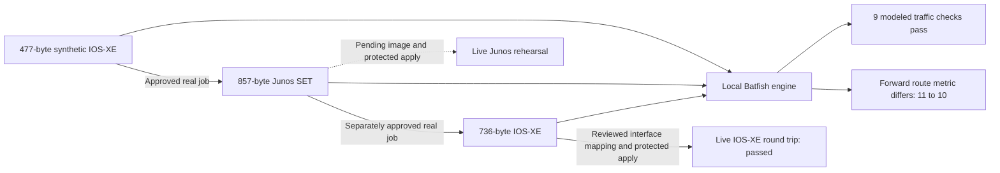

# Spec162 verification

## Current status

Source is **1.15.5**, extension source remains **1.5.0**, unpublished.
**43/44 tasks are checked**: T035 and T036 have actual image/bootstrap/access
and protected appliance behavior evidence. T034 fresh native installation
acceptance remains open. Five original review loops and the first two additional live loops
are complete; the third is in progress. Two separately approved real synthetic
conversions completed with provider review findings preserved.

### November 1 live qualification

- Actual CML authentication works. Its enforced limit is **five licensed nodes**,
  despite a feature description mentioning twenty. The owner authorized stop/start
  juggling. Real private R1/R2 baselines were captured first; their first restoration
  returned both to BOOTED with configuration equal except display timestamp/size
  metadata. The second scoped round also restored both to BOOTED and verified
  the same baseline equality. All owned rehearsal nodes are stopped and retained;
  the rehearsal Local/Lab write policy is disabled.
- Actual owned IOS-XE **17.18.2** target and modern peer booted with management in
  separate MGMT VRFs and an isolated synthetic test link. An initial bootstrap's
  32-character password was rejected (device limit 25); the retained replacement
  uses 24 characters. The IOSv peer's legacy-only SSH negotiation failed; it is
  stopped and retained, replaced by the same available modern IOS-XE image.
- Native NetClaw/Claude composed, validated and activated the dynamic CML inventory,
  collected private running baselines and obtained actual version/interface/route
  evidence. A model's claim that the peer lacked its management VRF was incorrect;
  the private baseline confirms both the VRF and interface binding. Typed device
  evidence takes precedence over the narrative.
- Target reboot regenerated its RSA key. Strict host checking rejected the stale
  entry. The new key was read through the exact-node CML console over scoped pinned
  TLS and matched against SSH keyscan before updating only that owned target entry.
  Subsequent actual NetClaw private collection and read commands passed.
- The native HUD exposed missing reference JSON imports and gateway SecretRef
  authentication errors. Source fixes and focused regressions pass. Scoped repairs
  preserve original bound source files, private backups and the original partial
  installation journal. Actual Chrome now renders the HUD, Canvas and Intent.
- OpenClaw **2026.7.1-2** ends STDIO children between turns. Added an explicit
  authenticated foreground pyATS session: actual separate SDK clients and native
  agent turns retain the same live inventory; unauthenticated access fails; owner
  exit invalidates the session. Original configuration-tool identities and private
  candidate/grant binding are unchanged. No inventory receipt or grant was forged.
- Actual HUD review captured the adapted candidate, designated only the owned
  target and created the real Local/Lab record. The first real record completed application and behavior checks, but exposed
  baseline-file substitution as described below. It is not counted as clean acceptance.
  Original reverse output SHA-256 `b13f9f92bcfa7dfe463fe70d2dfac220870bc620b73f80e93dff8358a5477282`;
  sole adaptation `GigabitEthernet0/0/1` → `Ethernet0/2`;
  reviewed 727-byte SHA-256 `020df9533e5549c6e28f3de5273e9478d8008cf16ca904bb80d22e7a6506ef0f`.

Current regressions: **69 NetConverter tests** (29.987s), **9 actual pinned
pyATS/session tests** (14.021s), **10 focused Node entries**, **8 deployment tests**,
and **274 setup tests with 32 optional skips**. One direct unittest module invocation
failed because its sibling imports require discovery; the corrected discovery run
passed all eight deployment tests. No new extension changes or publication.

The first actual API-issued apply used the original `pyats_configure_device`
identity and returned `applied_unverified`, followed by actual device checks:
OSPF FULL on both ends; reciprocal loopback routes with metric 11; positive pings
5/5 in both directions; unadvertised-prefix negative pings 0/3 in both directions;
management VRFs preserved and fresh private target collection successful.

That live run exposed an approval-evidence defect: the agent overwrote the
record's genuine baseline file with a metadata reference note. The original
1905-byte configuration remained safely retained in the private artifact store,
but the API accepted the substituted file. The source now writes a collector
receipt bound to record/installation/harness/testbed/endpoint and verifies the
exact baseline against the original captured artifact before APPLY, and again
in the consumer. A regression reproduced the defect before the fix; 18 private
apply tests now pass, including reference substitution and changed original
artifact refusal. The original completed record and results remain unmodified;
a clean reset/review/apply repeat has now passed, as recorded below.

### Clean protected repeat — passed

Actual browser review created record `74ce25ed-b2e7-486e-bb13-b3a7b389e4a1`.
The target started from its observed management-only bootstrap: no Loopback0,
no OSPF process and an unassigned, shut test interface. The real NetClaw agent
collected the 1905-byte baseline and left its collector-written bytes and receipt
intact. The API transitioned from PREPARE to APPLY with one grant; the original
`pyats_configure_device` tool consumed it once and returned `applied_unverified`,
with `replay: false`. Actual readbacks then completed the record successfully.

| Assertion | Actual target | Independent peer readback |
|---|---|---|
| OSPF adjacency | FULL, point-to-point on Ethernet0/2 | FULL on Ethernet0/1 |
| Remote loopback route | 192.0.2.2/32, metric 11 | 192.0.2.1/32, metric 11 |
| Positive loopback ping | 5/5, 1 ms | 5/5 |
| Unadvertised-prefix negative ping | 0/3 | 0/3 |
| Management continuity | Ethernet0/0 up; MGMT VRF retained; private post-read succeeds | MGMT VRF retains Ethernet0/0 |

Baseline SHA-256 `58992b79cc0cd5952bfa7cad274b4239177f7756477f0772e944ca946662a44f`
matches the retained original and the API record. Receipt bindings match the
actual record, installation, live harness, inventory and endpoint. Post-change
private configuration is 2311 bytes, SHA-256
`8244a58c2d6aa8fff874fd0da73038a43e8509a35c3b76b35aa297f28fccae1f`.
The consumed-attempt marker remains its immutable pre-write `unknown` reservation;
the separately retained tool result, device readbacks and completed API record
provide outcome evidence. It is not reset or replayed.

Private evidence: `protected-apply-final-completed.json`, `protected-final-audit.json`,
`final-intent-typed-evidence/` and `peer-final-verification/assertions.json` beneath
the owner-only `spec162-live-20261031` evidence directory. No running configuration,
credential or private topology is copied into this repository.

T036 passes for the IOS-XE round-trip reference. Source, Junos and reverse candidates
also have the separately recorded Batfish comparison; Junos metric 10 versus IOS-XE
11 remains visible. No original-source appliance or Junos appliance comparison is
claimed. Rollback is an actionable retained plan, not a claimed executed rollback test.

T034 remains open. A clean source worktree pinned to `93514861` and a new empty-home
four-component native plan passed validation, explanation and host/port checks.
The plan hash is `3d5f2e5f6610279d87efd026dddf4db97dd8b69b344497ec3778c50813278ac1`.
It covers NetConverter, pyATS, Batfish, GAIT, gateway and HUD; the separately qualified
CML adapter remains outside this fresh installation. Human native review is pending.

No Junos image is installed. Forward Junos appliance behavior and other vendors
remain unqualified; the available IOS-XE round-trip reference does not imply them.

## Initial planning evidence (historical)

- Owner chose exact-file approval before each hosted submission.
- Owner chose actual creation and testing of virtual migration targets wherever feasible.
- Public upstream research pinned Terminal source `ef28f5613a5f014dca7e8b2e38b8219cb461559f` and PyPI 0.5.0 metadata; see research.md for provenance and limits.
- Three read-only Spec Kit research agents examined transport/approval, installer integration and lab/configuration paths. No live calls, source implementation or credentials were performed by those agents.
- Before Docker startup, the selected daemon socket was unavailable. Later live discovery below supersedes this observation.
- Connected NetClaw read-only inventory request failed with MCP internal error and no job ID. Remote lab availability remains unknown.
- No local NetConverter executable on PATH; bounded repository environment-name checks found no relevant account/lab settings. No credential values read.
- Startup pyATS inventory initially failed. Later direct local MCP discovery below succeeded.

## Historical live qualification evidence — 2026-10-31

| Gate | Observed status | Remaining evidence |
|---|---|---|
| Account and licensed client | Official 0.6.0 wheel verified; delegated license acceptance succeeded; authenticated strict hosted/Terminal discovery | Native installer/desktop/platform acceptance remains separate |
| Exact synthetic transfer approval | Operator approved each file in the native CLI; two one-use submissions completed and six downloads verified | Further submissions always require their own review |
| Compatible lab host/image | CML 2.10 authenticated; 12 images including IOS-XE 17.18.2; evaluation license active; no Junos image | Junos image for forward appliance acceptance, capacity and isolated management/bootstrap |
| Real selected runtime | Owner completed native plan review and secret entry; OpenClaw 2026.7.1-2 gateway/HUD run; actual Claude response and NetConverter discovery succeed after scoped repair; scoped CML discovery succeeds on November 1 | Original setup remains partial; selected CML credentials are rejected and full native acceptance remains open |
| Protected artifact apply route | Source/control fixtures implemented; real isolated runtime now exists | Exact endpoint designation, genuine baseline/rollback and API APPLY transition, with actual target verification |
| Real vendor-target migration rehearsal | Not run | Boot, authorized import/readback and actual positive/negative assertions |
| Windows/WSL and harness-specific acceptance | Not run | Actual isolated platform observations; no inference from Mac/fixtures |

Actual discovery qualifies 47 text conversion paths, 14 validate and 14 optimize
combinations. Seven non-text handoff combinations are unqualified. Text includes
advertised UTF-8 Palo Alto XML; prescan/guided-draft operations remain outside the
guard's submission profile. This is one account's observed catalog, not a promise
for every subscription.

The public synthetic source is 477 bytes, SHA-256
`1482db1f8f905b59d12d58801ca25e10ee43f97b2ba034f4f86945d333a1cb7f`.
Forward IOS-XE → Junos SET produced an 857-byte candidate, SHA-256
`8d870d86554ed10d2df53004579eace4e2e2fad67250cc11bc8760857e4e357a`.
Reverse submission of those exact bytes produced a 736-byte IOS-XE candidate,
SHA-256 `b13f9f92bcfa7dfe463fe70d2dfac220870bc620b73f80e93dff8358a5477282`.
Both jobs completed with zero blocking reasons and seven review reasons. Forward
has six warnings/one manual-review item; reverse has six warnings/five manual
items. Both report partial coverage, truncated evidence digests and no detailed
report. The provider's forward OSPF analysis passed while other behavior categories
were inconclusive. No provider analysis is represented as device observation.

CML certificate trust was scoped to its observed certificate and matching DNS
identity (trust on first use, not independent PKI validation). Read-only inventory
found eight x86 cores, 4.10 GB RAM total and 2.02 GB free; two default IOL routers
need 2 GiB before overhead. Existing labs/devices and the reported orphan remain
untouched. No image is inferred from a node definition. Native CUA still fails
its pipe startup. See the additional loop record for exact provenance and limits.

## CML retry — 2026-11-01

The owner's requested retry succeeded against the actual CML API: HTTP 200,
version 2.10.0+build.13, using the previously established private session and
scoped certificate verification. Fresh reads found two labs, six running nodes,
one existing orphan, 12 installed images and 45 node definitions. Free RAM was
1,953,910,784 bytes (about 1.95 GB), with 4.10 GB total and eight CPUs. IOS-XE
17.18.02 is installed; no Junos image is present. Licensing reports Personal EVAL
with an authorization expiry of 2027-01-22. Existing resources remain untouched.

The registered MCP connection still failed startup. A temporary loopback TLS
adapter preserved verification to the same pinned CML endpoint and allowed only
GET plus authentication; a PUT denial returned HTTP 403 without forwarding.
The actual OpenClaw MCP probe then discovered **51 CML tools**, without diagnostics.
This is discovery only: all attempted read tools failed authentication. A separate
direct native HTTPS authentication check, bypassing the adapter, also returned
HTTP 403 with the rehearsal's saved credentials. The earlier session still reads
the API. Credentials were not printed or silently changed; the owner was asked
for the current local credential source.

The first adapter attempt used HTTP, which the installed virl2 client refuses;
the TLS-only probe corrected that qualification mistake without disabling TLS
checks. The probe used a private temporary config, not a replacement live
registration. No source code, device configuration, lab resources or setup journal
changed. CML reachability is restored; selected-account authentication, target
image/bootstrap and protected application remain open. T034–T036 stay unchecked.

## Real minimal NetClaw and native installer fixes — 2026-10-31

The owner completed the actual native plan confirmation and three private secret
prompts. The installer created an isolated OpenClaw 2026.7.1-2 home with five MCP
components, ten skills, no communication channels, dynamic CML inventory policy
and testing posture. Gateway/HUD identity verification passed. Its original
journal ended `configuration_required`: NetConverter failed dependency observation,
and pyATS/CML discovery did not pass. That record remains unchanged.

- NetConverter's source-tree venv interpreter is a symlink. The dependency
  observer correctly rejects source symlinks; the installer now places this venv
  under the selected runtime root. A new regression failed before the fix and
  passed afterward. Scoped maintenance created that environment and added only
  the missing guard registration; existing configuration was checked unchanged.
- The native pyATS adapter had an independent old revision (`f11b02f…`) while
  the staged installer used the qualified dynamic revision (`4a3c1e3…`). It
  installed a server requiring a static file, so dynamic startup exited. A new
  regression reproduced the wrong checkout. Native installation and observation
  now use the staged installer's revision and complete required-file contract.
  The rehearsal's previous runtime is retained; its repaired generation discovers
  35 tools and passes six actual dynamic-runtime tests with synthetic inventories.
- The owner explicitly selected the repository's Anthropic key after a bad paste.
  Only this new claw's provider setting changed; a private backup and hashes were
  retained. Models API authentication returned HTTP 200, and an actual gateway
  turn using Claude Sonnet 4.6 returned `SPEC162_PROVIDER_OK`.
- A real agent invoked the guard after the official Terminal's same v1.0 license
  was accepted in this separate home under the owner's earlier delegation.
  Typed MCP evidence reports installed/discovered/authenticated/capable true,
  nine reads, 75 qualified combinations and seven unqualified combinations.
  The initial generic unavailable response was a license-state issue, not proof
  of an upstream network outage. Narrative count errors are not used as evidence.
- Native discovery verifies NetConverter 8, pyATS 35, Batfish 8 and GAIT 23 tools.
  GAIT was initialized in the selected workspace and records actual local turns.
  Dynamic inventory reports `active: none`; device listing correctly refuses
  until an inventory is explicitly activated. No device access is inferred.
- A subsequent real Claude-driven turn calls pyATS, validates all three Batfish
  snapshots and records/logs GAIT. All three return PASS/complete parsing with
  `behavioral_equivalence: not_established_by_parsing`. The reverse target is the
  actual downloaded IOS-XE candidate; one narrative sentence mislabeled it as a
  peer. The private snapshot manifest and typed tool evidence remain authoritative.
  CML currently times out, including a native HTTPS recheck. Existing lab resources
  remain untouched. No candidate has been applied to an appliance.

The bound installation source and original setup journal were not rewritten to
claim a fresh installer pass. Separate maintenance receipts record runtime
replacement, additive registration, policy append/backups and source-binding
verification. Desktop CUA remains unavailable. T034–T036 therefore stay open.

Regression evidence: 67 NetConverter tests (31.147s); 273 setup tests run
(40.239s, 27 optional skips); four staged-runtime recovery tests (0.04s); six
actual dynamic-runtime tests (15.700s). Catalog coverage and the owned guard's
dependency check pass. A broad dependency scan flags an unrelated local HumanRail
checkout's unbounded MCP requirement; it is not silently classified as passing.

## Actual local Batfish cross-composition

A separate run-owned official ARM64 Batfish container analyzed the unchanged
synthetic source, real returned Junos SET and real returned IOS-XE candidates.
Each snapshot includes the same authored IOS-XE peer. L3 connectivity is modeled
from the synthetic point-to-point subnet; no real cable or forwarding is inferred.

| Observed model result | Source IOS-XE | Converted Junos | Reverse IOS-XE |
|---|---|---|---|
| Parse status (candidate + peer) | 2/2 passed | 2/2 passed | 2/2 passed |
| Initialization issues | 0 | 0 | 0 |
| Directed OSPF session rows | 2 established | 2 established | 2 established |
| Positive loopback traces, both directions | Accepted | Accepted | Accepted |
| Unadvertised-prefix control | No route | No route | No route |
| Active link cost / passive loopback | 10 / true | 10 / true | 10 / true |
| Peer route metric to converted loopback | 11 | **10 — differs** | 11 |

Nine modeled traffic assertions pass. Forward route-metric equality is false;
Junos's modeled loopback cost is 0 versus IOS-XE's 1. This remains a review
finding, with original output preserved. Full semantic equivalence is not claimed.
Actual Batfish MCP discovery and three validation calls report complete parsing
while explicitly declining to establish behavior from parsing. Neither those
calls nor modeled traces replace appliance/traffic tests. The later real IOS-XE
repeat is recorded separately above; Junos appliance qualification remains open.

## Implementation evidence

`python3 -m unittest discover -s tests/netconverter -p test_core.py`: 10 tests passed on Python 3.14.6, after first recording the expected missing-module failure. Tests cover metadata-only results, exact digest/expiry, eight competing claims with one winner, restart unknown state, changed source/snapshot/capability/key/account/executable, receipt integrity, connection-bound jobs, path/link/FIFO/size/no-clobber boundaries and unsupported operations. These are synthetic local boundary tests, not upstream conversion acceptance. Runtime Python 3.12 qualification follows.

## Earlier local-lab discovery after Docker startup (historical)

- Linux ARM64 Docker daemon: 14 CPUs, 8,318,976,000 bytes memory; existing containers preserved.
- Existing local pyATS HTTP MCP: official SDK handshake, 34 tools discovered, `pyats_list_devices` successful.
- Existing four-port SSH relay configuration maps exactly to the owner-identified local device addresses. No testbed edit or active-inventory replacement was needed; DevNet sandbox endpoints were not used.
- `pyats_run_show_command_multi` / `show version`: requested 4, success 4, failed 0. R1/R2/SW1/SW2 hostnames matched; version 17.18.2, distinct routing and L2 IOL images. This establishes live source identity only.
- Raw show output and private addressing remain in ignored local memory. No running configuration was uploaded, no device/lab configuration was changed.
- CML native reachability succeeds; browser HTTPS reports an untrusted certificate. Installed Junos images have not been enumerated.
- Native LAN reachability and Python socket reachability differ on this Mac. Do not infer host downtime from Python's `No route to host`; the existing native relay is functional.

Preferred live scenario: [IOS-XE→JunOS OSPF reference](reference-ospf.md). Account/image/control prerequisites remain open.

Planning verification: 44 sequential unique tasks; 19 FR and 6 SC mapped; all local documentation links and whitespace checks passed. Three design refinements resolved (collector tool specificity, candidate capability issuer/consumer, story priority consistency). This was the T001/T002 checkpoint before implementation; the current task tracker supersedes that historical state.

## Initial implementation checks (before Ralph rounds)

| Check | Actual result and scope |
|---|---|
| Feature suite, isolated Python 3.12.12 / official SDK 2.3.0 / FastMCP 4.0.11 | **47 passed**, 20.165s. Private capture, disclosure grants, real controlled stdio/HTTP peer transport, explicit job association/budget, API signer → Python apply consumer, private collection including fixed Junos command, native PTY settings/approval, rehearsal ownership, Batfish coverage and composition. |
| Managed pinned pyATS / actual schema runtime | **6 passed**, 15.527s. Same 35 tool identities, additive artifact arguments, actual builder/validation and process-bound receipt. Synthetic inventory; no device calls. |
| Setup regression family | **272 run; 240 passed, 32 skipped**, 35.217s. No skipped live stage is a pass. |
| Existing pyATS bridge/recovery | **15 passed**, 3.31s, isolated pytest runtime. Initial invocation with system Python lacked pytest; corrected by using the existing isolated runtime. |
| VS Code full suite | **152 run; 149 passed, 3 skipped**, 27.997s on Node 24.19.0. Subsequent new actual-wizard picker/cancel test: focused **3 passed**. |
| HUD unit suite | **383 passed**, 4.943s. |
| Terminal policy and execution suites | PASS, existing local API/HTTP/idempotency tests, no live Gateway. |
| New migration UI | PASS, real JSX in JSDOM: local file upload, hash display, process/profile review, decline and metadata-only parent state. Not desktop acceptance. |
| HUD production build | PASS; existing large-bundle warning remains. |
| Catalog | PASS: 111 components, 238 skills, 125 registered + 52 external integrations = 177. |
| Skill validator | PASS for adapted skill; original archive retained with matching SHA-256. |
| Native controlling-terminal tests | **2 passed**: both settings modes/cancel/preservation and synthetic exact-digest approval/decline. No real disclosure grant or upload. |
| Desktop automation | CUA failed to start its native pipe. No visual desktop acceptance claimed. |
| Broad MCP reconciliation | Catalog/docs/portability/package/ID checks pass. Dependency/startup checks fail on pre-existing owner checkout/runtime dependencies (including untracked HumanRail clone and missing optional modules/entrypoints). Owner installations were not changed to make this scan pass. |

### Choreography and skill decision checks

The controlled CML-shaped peer received actual official-SDK discover → create →
add-node → start → inspect calls. A second case accepted creation then lost its
response; the harness discovered the exact run/attempt ownership and continued
without a duplicate create. This is a manually selected choreography exercised
through real MCP transport, not an autonomous LLM evaluation or a real lab.

Manual execution-decision review against the current skill/reference contracts:

| Fixture condition | Required decision checked |
|---|---|
| Eligible synthetic image, capacity, scoped bootstrap and ownership | Create/boot/inspect using discovered names; keep candidate out of creation arguments. Actual controlled choreography tests pass. |
| CML definition only, EVE template only, or no remote file staging | Stop eligibility/apply at the missing image/bootstrap/transfer evidence; never invent an image or path. |
| FRR requested as native conversion target | Qualify actual vendor direction; unsupported path is refused by the capability tests. FRR peer use does not become target acceptance. |
| Original configuration route denies/loses response | Private apply result stays unknown; no alternate tool and no replay (actual consumer tests). |
| Deliberately failed negative traffic assertion; Jev disabled | Failed and blocked entries survive the composed local review package; no external provider/ticket call. |

### Private application limits

The real JavaScript API issuer and Python consumer are tested together. Original
configuration-tool identity/annotations remain; no new apply alias or grant tool
is registered. Controlled original-tool denial is verified. Real OpenClaw broker
policy acceptance is established by the clean IOS-XE repeat above. Live Junos
commit/readback remains unqualified.
Junos set-format collection/application are implemented at the existing identities;
installed Unicon source has commit behavior, but source inspection is not device
acceptance. Cached, ambiguous/proxy/console routes are refused. One candidate/one
endpoint per request; Hermes Local/Lab and production artifact grants unavailable.
Same-OS-user filesystem trust is explicit in the contract and guide.

Source compilation and controlled tests do not make live tasks complete. T035
and T036 now have separate actual evidence. The owner authorized temporary R1/R2
stop/start; both are restored and configuration equality verified. T034 remains open.

## Original implementation reconciliation (historical)

The final feature suite ran **61 tests, all passed, in 29.700 seconds** on isolated
Python 3.12.12, official MCP SDK 2.3.0 and FastMCP 4.0.11. Run with
`NETCLAW_TEST_NODE=/absolute/node24 /absolute/isolated/python -m unittest discover -s tests/netconverter -p 'test_*.py' -q`.
These are controlled fixtures/SDK transports, not service or appliance acceptance.

| Final check | Actual result |
|---|---|
| API-issued private apply/collection | 16 passed; current endpoint/policy/baseline checks, Junos separator refusal, private initialization/logging, post-write storage fault and cancellation guard retention |
| Real JSX migration UI | PASS in JSDOM; target/mode/profile changes and late file responses invalidate old review |
| Actual managed pyATS runtime/schema | 6 passed, 12.666s; preserved 35 identities, synthetic inventory only |
| Extension 1.5.0 source | TypeScript check and build PASS; 3 focused native-picker/validation tests PASS |
| HUD build after UI fixes | PASS; existing large-bundle warning |
| Setup deployment/effect audit | 7 passed, 0.546s |
| Catalog metadata and declaration reconciliation | PASS: 111 components, 238 skills, 177 integrations; counts and registration portability consistent |
| Website draft | Content generation PASS; Astro check 99 files, zero errors/warnings/hints; draft absent from generated posts and search |
| Provenance/privacy/whitespace | Supplied archive hash matches; new-source private-environment scan and `git diff --check` PASS |

Full initial installer/HUD/extension/bridge results above remain scoped evidence;
unchanged passing suites were not mechanically rerun. The broad owner-runtime
reconciliation failure remains visible and was not relabeled as a pass.

### Requirements and practical limits

| Requirements | Implemented evidence | Remaining qualification |
|---|---|---|
| FR-001–003 | Catalog/installers, guarded registration, fixed modes and isolated SDK transport | Native desktop/platform pass (T034); real client/account discovery now observed |
| FR-004–005 | Adapted skill/provenance and explicit role/class/text capability tests | Account directions/limits now observed; non-text/archive and incomplete metadata unavailable |
| FR-006–009, FR-017 | Exact native review, durable single-use attempts, binding/integrity/unknown cases, restricted read surface | Two approved real jobs now observed; advanced draft mutations unavailable |
| FR-010–013 | Private collector and composition contracts; actual licensed CML target, protected native apply, observed OSPF/traffic matrix and retained ownership/evidence (T035–T036 pass) | Other lab platforms, vendor appliances and separately authorized external reviewers/tickets remain unqualified |
| FR-014–016 | 69 controlled feature tests after live fixes, broader regressions, five original loops, two completed extra loops and ongoing third, actual conversion/appliance evidence and article | T034 fresh native acceptance and completion of live loop 3 remain open; 43/44 tasks |
| FR-018–019 | Actual JS issuer/Python consumer and native protected IOS-XE apply; original identity, exact captured baseline checks, guarded cancellation and Batfish failure/coverage tests | Junos commit/readback and other runtime/platform routes remain unqualified; no universal equivalence claim |

SC-001/002/004 have controlled and actual service evidence; native UI scope remains
open. SC-003 has explicit source/lab handoff limits. SC-005 has all five recorded
iterations. SC-006 has an actual image-backed IOS-XE target, protected native apply,
positive/negative behavior checks, retained resources and verified owner restoration.
Unavailable Junos and hardware-specific behavior remain explicit limits.

The authored [synthetic IOS-XE OSPF input](examples/README.md) has now completed
its approved real conversion. It has not been applied and does not establish
the existing routers' protocol state.

### Remaining native acceptance

T034 is the sole open task. Complete the exact reviewed fresh installation using
the pinned source and new home described above; inspect its authoritative journal,
required verification tiers and actual HUD/guard discovery. Preserve the first
partial journal and repair history. Only close live loop 3 and report 44/44 after
this pass succeeds. No additional hosted transfer, appliance write or publication
is implied by native installation review.

Junos appliance testing needs a separately available licensed router image; it is
not claimed by the completed IOS-XE round-trip reference. Other vendors/platforms
retain the handoff and qualification states in the composition matrix.

The separate modern_website article already has `draft: false` in the owner's
current clean checkout; its publication flag was not changed by this session.
No external ticket, source release or Marketplace package was published here.

### Local audit and handoff

GAIT session `spec162-netconverterai-20261030` records planning, live read-only
observations, implementation and review milestones, including final source
reconciliation `ca420cff`. Ignored daily memory was appended with the later Docker/
local-pyATS findings, changes, actual results and remaining gates. No external
record was created. Final Git checkpoint and GAIT trail accompany the handoff.

## Owner-requested Risk installer simulation — in progress

The owner superseded the pending four-component Focused plan: retire the temporary
claw and test a Border with one NetConverter member. Review inputs are simulated
for this expressly requested automated test; installation, services, federation
and guarded account discovery must still have actual evidence. The original human
native review and partial journal remain retained. No simulated input is described
as a fresh human UI approval.

This uncovered the missing canonical member profile. The new test first rejected
the plan with `unsupported_member_profile`, then passed after adding the guarded
OpenClaw NetConverter profile. Border domain-component refusal, member-owned
settings and generated private state are checked. T034 remains open until the
actual requested Risk installation and verification finish.
