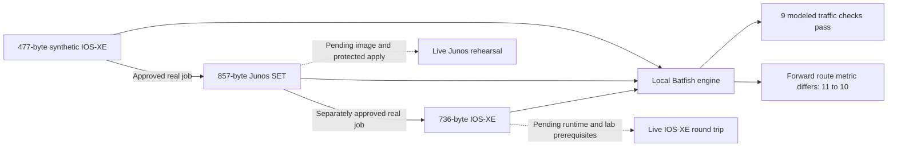

# Spec162 verification

## Current status

Source implementation and five original review/fix/test iterations are complete.
Three additional live qualification loops are recorded in [live-iterations.md](live-iterations.md).
Source is now **1.15.1**, extension source remains **1.5.0**; neither is published
by this session. **41 of 44 tasks remain checked**: T034–T036 are partly advanced,
not complete. Actual Terminal 0.6.0/account discovery and two separately approved
synthetic conversions succeeded. Both returned **needs review**. No live device
application, Junos appliance acceptance or forwarding pass is claimed.

## Initial planning evidence (historical)

- Owner chose exact-file approval before each hosted submission.
- Owner chose actual creation and testing of virtual migration targets wherever feasible.
- Public upstream research pinned Terminal source `ef28f5613a5f014dca7e8b2e38b8219cb461559f` and PyPI 0.5.0 metadata; see research.md for provenance and limits.
- Three read-only Spec Kit research agents examined transport/approval, installer integration and lab/configuration paths. No live calls, source implementation or credentials were performed by those agents.
- Before Docker startup, the selected daemon socket was unavailable. Later live discovery below supersedes this observation.
- Connected NetClaw read-only inventory request failed with MCP internal error and no job ID. Remote lab availability remains unknown.
- No local NetConverter executable on PATH; bounded repository environment-name checks found no relevant account/lab settings. No credential values read.
- Startup pyATS inventory initially failed. Later direct local MCP discovery below succeeded.

## Current live qualification evidence — 2026-10-31

| Gate | Observed status | Remaining evidence |
|---|---|---|
| Account and licensed client | Official 0.6.0 wheel verified; delegated license acceptance succeeded; authenticated strict hosted/Terminal discovery | Native installer/desktop/platform acceptance remains separate |
| Exact synthetic transfer approval | Operator approved each file in the native CLI; two one-use submissions completed and six downloads verified | Further submissions always require their own review |
| Compatible lab host/image | CML 2.10 authenticated; 12 images including IOS-XE 17.18.2; evaluation license active; no Junos image | Junos image for forward appliance acceptance, capacity and isolated management/bootstrap |
| Protected artifact apply route | Source/control fixtures implemented; no live local Intent/Gateway listener found | Real selected runtime, exact endpoint designation, genuine baseline/rollback and API APPLY transition |
| Real vendor-target migration rehearsal | Not run | Boot, authorized import/readback and actual positive/negative assertions |
| Windows/WSL and harness-specific acceptance | Not run | Actual isolated platform observations; no inference from Mac/fixtures |

Actual discovery qualifies 47 text conversion paths, 14 validate and 14 optimize
combinations. Seven non-text handoff combinations are unqualified. Text includes
advertised UTF-8 Palo Alto XML; prescan/guided-draft operations remain outside the
guard's submission profile. This is one account's observed catalog, not a promise
for every subscription.

The public synthetic source is 477 bytes, SHA-256
`1482db1f8f905b59d12d58801ca25e10ee43f97b2ba034f4f86945d333a1cb7f`.
Forward IOS-XE → Junos SET produced an 857-byte candidate, SHA-256
`8d870d86554ed10d2df53004579eace4e2e2fad67250cc11bc8760857e4e357a`.
Reverse submission of those exact bytes produced a 736-byte IOS-XE candidate,
SHA-256 `b13f9f92bcfa7dfe463fe70d2dfac220870bc620b73f80e93dff8358a5477282`.
Both jobs completed with zero blocking reasons and seven review reasons. Forward
has six warnings/one manual-review item; reverse has six warnings/five manual
items. Both report partial coverage, truncated evidence digests and no detailed
report. The provider's forward OSPF analysis passed while other behavior categories
were inconclusive. No provider analysis is represented as device observation.

CML certificate trust was scoped to its observed certificate and matching DNS
identity (trust on first use, not independent PKI validation). Read-only inventory
found eight x86 cores, 4.10 GB RAM total and 2.02 GB free; two default IOL routers
need 2 GiB before overhead. Existing labs/devices and the reported orphan remain
untouched. No image is inferred from a node definition. Native CUA still fails
its pipe startup. See the additional loop record for exact provenance and limits.

## Actual local Batfish cross-composition

A separate run-owned official ARM64 Batfish container analyzed the unchanged
synthetic source, real returned Junos SET and real returned IOS-XE candidates.
Each snapshot includes the same authored IOS-XE peer. L3 connectivity is modeled
from the synthetic point-to-point subnet; no real cable or forwarding is inferred.

| Observed model result | Source IOS-XE | Converted Junos | Reverse IOS-XE |
|---|---|---|---|
| Parse status (candidate + peer) | 2/2 passed | 2/2 passed | 2/2 passed |
| Initialization issues | 0 | 0 | 0 |
| Directed OSPF session rows | 2 established | 2 established | 2 established |
| Positive loopback traces, both directions | Accepted | Accepted | Accepted |
| Unadvertised-prefix control | No route | No route | No route |
| Active link cost / passive loopback | 10 / true | 10 / true | 10 / true |
| Peer route metric to converted loopback | 11 | **10 — differs** | 11 |

Nine modeled traffic assertions pass. Forward route-metric equality is false;
Junos's modeled loopback cost is 0 versus IOS-XE's 1. This remains a review
finding, with original output preserved. Full semantic equivalence is not claimed.
Actual Batfish MCP discovery and three validation calls report complete parsing
while explicitly declining to establish behavior from parsing. Neither those
calls nor modeled traces replace the remaining appliance/traffic tests.

## Implementation evidence

`python3 -m unittest discover -s tests/netconverter -p test_core.py`: 10 tests passed on Python 3.14.6, after first recording the expected missing-module failure. Tests cover metadata-only results, exact digest/expiry, eight competing claims with one winner, restart unknown state, changed source/snapshot/capability/key/account/executable, receipt integrity, connection-bound jobs, path/link/FIFO/size/no-clobber boundaries and unsupported operations. These are synthetic local boundary tests, not upstream conversion acceptance. Runtime Python 3.12 qualification follows.

## Earlier local-lab discovery after Docker startup (historical)

- Linux ARM64 Docker daemon: 14 CPUs, 8,318,976,000 bytes memory; existing containers preserved.
- Existing local pyATS HTTP MCP: official SDK handshake, 34 tools discovered, `pyats_list_devices` successful.
- Existing four-port SSH relay configuration maps exactly to the owner-identified local device addresses. No testbed edit or active-inventory replacement was needed; DevNet sandbox endpoints were not used.
- `pyats_run_show_command_multi` / `show version`: requested 4, success 4, failed 0. R1/R2/SW1/SW2 hostnames matched; version 17.18.2, distinct routing and L2 IOL images. This establishes live source identity only.
- Raw show output and private addressing remain in ignored local memory. No running configuration was uploaded, no device/lab configuration was changed.
- CML native reachability succeeds; browser HTTPS reports an untrusted certificate. Installed Junos images have not been enumerated.
- Native LAN reachability and Python socket reachability differ on this Mac. Do not infer host downtime from Python's `No route to host`; the existing native relay is functional.

Preferred live scenario: [IOS-XE→JunOS OSPF reference](reference-ospf.md). Account/image/control prerequisites remain open.

Planning verification: 44 sequential unique tasks; 19 FR and 6 SC mapped; all local documentation links and whitespace checks passed. Three design refinements resolved (collector tool specificity, candidate capability issuer/consumer, story priority consistency). This was the T001/T002 checkpoint before implementation; the current task tracker supersedes that historical state.

## Initial implementation checks (before Ralph rounds)

| Check | Actual result and scope |
|---|---|
| Feature suite, isolated Python 3.12.12 / official SDK 2.3.0 / FastMCP 4.0.11 | **47 passed**, 20.165s. Private capture, disclosure grants, real controlled stdio/HTTP peer transport, explicit job association/budget, API signer → Python apply consumer, private collection including fixed Junos command, native PTY settings/approval, rehearsal ownership, Batfish coverage and composition. |
| Managed pinned pyATS / actual schema runtime | **6 passed**, 15.527s. Same 35 tool identities, additive artifact arguments, actual builder/validation and process-bound receipt. Synthetic inventory; no device calls. |
| Setup regression family | **272 run; 240 passed, 32 skipped**, 35.217s. No skipped live stage is a pass. |
| Existing pyATS bridge/recovery | **15 passed**, 3.31s, isolated pytest runtime. Initial invocation with system Python lacked pytest; corrected by using the existing isolated runtime. |
| VS Code full suite | **152 run; 149 passed, 3 skipped**, 27.997s on Node 24.19.0. Subsequent new actual-wizard picker/cancel test: focused **3 passed**. |
| HUD unit suite | **383 passed**, 4.943s. |
| Terminal policy and execution suites | PASS, existing local API/HTTP/idempotency tests, no live Gateway. |
| New migration UI | PASS, real JSX in JSDOM: local file upload, hash display, process/profile review, decline and metadata-only parent state. Not desktop acceptance. |
| HUD production build | PASS; existing large-bundle warning remains. |
| Catalog | PASS: 111 components, 238 skills, 125 registered + 52 external integrations = 177. |
| Skill validator | PASS for adapted skill; original archive retained with matching SHA-256. |
| Native controlling-terminal tests | **2 passed**: both settings modes/cancel/preservation and synthetic exact-digest approval/decline. No real disclosure grant or upload. |
| Desktop automation | CUA failed to start its native pipe. No visual desktop acceptance claimed. |
| Broad MCP reconciliation | Catalog/docs/portability/package/ID checks pass. Dependency/startup checks fail on pre-existing owner checkout/runtime dependencies (including untracked HumanRail clone and missing optional modules/entrypoints). Owner installations were not changed to make this scan pass. |

### Choreography and skill decision checks

The controlled CML-shaped peer received actual official-SDK discover → create →
add-node → start → inspect calls. A second case accepted creation then lost its
response; the harness discovered the exact run/attempt ownership and continued
without a duplicate create. This is a manually selected choreography exercised
through real MCP transport, not an autonomous LLM evaluation or a real lab.

Manual execution-decision review against the current skill/reference contracts:

| Fixture condition | Required decision checked |
|---|---|
| Eligible synthetic image, capacity, scoped bootstrap and ownership | Create/boot/inspect using discovered names; keep candidate out of creation arguments. Actual controlled choreography tests pass. |
| CML definition only, EVE template only, or no remote file staging | Stop eligibility/apply at the missing image/bootstrap/transfer evidence; never invent an image or path. |
| FRR requested as native conversion target | Qualify actual vendor direction; unsupported path is refused by the capability tests. FRR peer use does not become target acceptance. |
| Original configuration route denies/loses response | Private apply result stays unknown; no alternate tool and no replay (actual consumer tests). |
| Deliberately failed negative traffic assertion; Jev disabled | Failed and blocked entries survive the composed local review package; no external provider/ticket call. |

### Private application limits

The real JavaScript API issuer and Python consumer are tested together. Original
configuration-tool identity/annotations remain; no new apply alias or grant tool
is registered. Controlled original-tool denial is verified. Real OpenClaw broker
policy acceptance and a live Junos commit/readback remain live qualification.
Junos set-format collection/application are implemented at the existing identities;
installed Unicon source has commit behavior, but source inspection is not device
acceptance. Cached, ambiguous/proxy/console routes are refused. One candidate/one
endpoint per request; Hermes Local/Lab and production artifact grants unavailable.
Same-OS-user filesystem trust is explicit in the contract and guide.

Source compilation and controlled tests do not make T034–T036 complete. Existing
owner labs/devices remain unchanged. The later live account/license actions above
supersede the original no-service-action state.

## Original implementation reconciliation (historical)

The final feature suite ran **61 tests, all passed, in 29.700 seconds** on isolated
Python 3.12.12, official MCP SDK 2.3.0 and FastMCP 4.0.11. Run with
`NETCLAW_TEST_NODE=/absolute/node24 /absolute/isolated/python -m unittest discover -s tests/netconverter -p 'test_*.py' -q`.
These are controlled fixtures/SDK transports, not service or appliance acceptance.

| Final check | Actual result |
|---|---|
| API-issued private apply/collection | 16 passed; current endpoint/policy/baseline checks, Junos separator refusal, private initialization/logging, post-write storage fault and cancellation guard retention |
| Real JSX migration UI | PASS in JSDOM; target/mode/profile changes and late file responses invalidate old review |
| Actual managed pyATS runtime/schema | 6 passed, 12.666s; preserved 35 identities, synthetic inventory only |
| Extension 1.5.0 source | TypeScript check and build PASS; 3 focused native-picker/validation tests PASS |
| HUD build after UI fixes | PASS; existing large-bundle warning |
| Setup deployment/effect audit | 7 passed, 0.546s |
| Catalog metadata and declaration reconciliation | PASS: 111 components, 238 skills, 177 integrations; counts and registration portability consistent |
| Website draft | Content generation PASS; Astro check 99 files, zero errors/warnings/hints; draft absent from generated posts and search |
| Provenance/privacy/whitespace | Supplied archive hash matches; new-source private-environment scan and `git diff --check` PASS |

Full initial installer/HUD/extension/bridge results above remain scoped evidence;
unchanged passing suites were not mechanically rerun. The broad owner-runtime
reconciliation failure remains visible and was not relabeled as a pass.

### Requirements and practical limits

| Requirements | Implemented evidence | Remaining qualification |
|---|---|---|
| FR-001–003 | Catalog/installers, guarded registration, fixed modes and isolated SDK transport | Native desktop/platform pass (T034); real client/account discovery now observed |
| FR-004–005 | Adapted skill/provenance and explicit role/class/text capability tests | Account directions/limits now observed; non-text/archive and incomplete metadata unavailable |
| FR-006–009, FR-017 | Exact native review, durable single-use attempts, binding/integrity/unknown cases, restricted read surface | Two approved real jobs now observed; advanced draft mutations unavailable |
| FR-010–013 | Private pyATS collector, composition contracts, actual controlled CML choreography, ownership ledger, OSPF topology/matrix/local ticket template | Actual licensed target, bootstrap/access, live broker permission and configuration/behavior acceptance (T035–T036) |
| FR-014–016 | 66 controlled feature tests after live fixes, broader regressions, five original plus three additional loops, docs and article | Live acceptance remains separate; source work is not 100% overall qualification |
| FR-018–019 | Actual JS issuer/Python consumer, original tool identity, guarded cancellation and Batfish failure/coverage tests | Real runtime policy, Junos commit/readback and forwarding evidence; no universal equivalence claim |

SC-001/002/004 have controlled and actual service evidence; native UI scope remains
open. SC-003 has explicit source/lab handoff limits. SC-005 has all five recorded
iterations. SC-006 is **not satisfied by fixtures**: no image-backed target has
been created or behavior-tested in this run.

The authored [synthetic IOS-XE OSPF input](examples/README.md) has now completed
its approved real conversion. It has not been applied and does not establish
the existing routers' protocol state.

### Resume the remaining live reference

1. Supply an installed licensed Junos router image for forward appliance testing,
   or complete the reviewed IOS-XE round-trip target scope using an available image.
   Establish sufficient capacity and isolated, reachable SSH management first.
2. Use the actual selected OpenClaw/Intent runtime and designate exact lab
   endpoints. Do not create a fixture issuer or bypass a denied tool to fill this gap.
3. Complete the native installer/desktop stage, genuine baseline/rollback, exact
   candidate review, API APPLY transition, commit/readback and positive/negative
   OSPF checks. A modeled Batfish result cannot close appliance acceptance.
4. Record all failed/unexecuted tests and retained resources before making a
   working-migration claim. No additional hosted transfer is implied by either
   existing approval.

The separate modern_website article already has `draft: false` in the owner's
current clean checkout; its publication flag was not changed by this session.
No external ticket, source release or Marketplace package was published here.

### Local audit and handoff

GAIT session `spec162-netconverterai-20261030` records planning, live read-only
observations, implementation and review milestones, including final source
reconciliation `ca420cff`. Ignored daily memory was appended with the later Docker/
local-pyATS findings, changes, actual results and remaining gates. No external
record was created. Final Git checkpoint and GAIT trail accompany the handoff.
