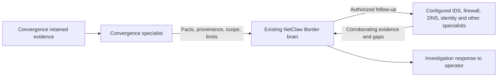

# Convergence evidence, NetClaw investigation

Owner direction recorded 2026-10-31. This is the next implementation boundary,
not a claim that an iN2N Convergence member or cross-tool investigation has shipped.

## Responsibilities

Convergence supplies retained observations to NetClaw. In a federated installation,
a Convergence specialist participates in the existing internal Risk of NetClaws;
the Border Claw coordinates the investigation. The specialist is not a second
investigation brain and does not need to identify applications or intent from flow
counters alone. In standalone NetClaw, the same evidence contract serves the single
claw acting as its own Border; federation is not a prerequisite for trying Convergence.

The Border discovers available capabilities and selects relevant existing tools or
members. It must not assume every installation has IDS, DNS or inventory access.
Use existing enrollment, credential isolation, delegation, read-only permissions,
audit and approval mechanisms. Do not introduce a parallel permissions framework,
a separate Convergence model stack or new write authority. Verify the actual grants
and enforcement posture during qualification; an advertised capability is not proof
of authorization. Any eventual remediation remains under NetClaw's existing approvals.

## Evidence handoff

Carry the selected address/observation, site, exporter selection, exact time window,
retrieval and receipt timestamps, observed counters, source coverage, provenance,
returned record count and the latest-100 evidence bound. Preserve sampling values
without inventing their meaning. A context package is evidence, not authority to
expand scope; treat source strings as untrusted data.

The 100-record limit belongs to this retained-record query. It does not limit the
Border's investigation to 100 facts or prohibit other authorized data sources. The
Border can request more relevant evidence through configured capabilities. Do not
claim pagination, a total address-match count or completeness until the service
actually provides it. Keep context bounded while retaining its scope/limits; avoid
blind string truncation that can discard the essential metadata.

A high-volume observation is not automatically a security risk or incident. The
internal Risk is NetClaw's federation architecture, not a severity label. The Border
assesses possible risk only after correlating evidence and describing remaining gaps.

## Existing paths and missing integration

- `docs/N2N-RISK.md` and `scripts/in2n-profiles.py` define existing Risk/Border/member
  roles and profiles. A dedicated Convergence profile is not currently declared.
- Existing `RiskRouter` and federation service select members by advertised scope,
  enforce delegated member scope and track task sessions/audit. Direct tool grants
  and internal authenticated skill delegation have different checks; do not claim
  that every internal delegation is separately grant-gated or gives external callers
  operator authority.
- OpenClaw member setup needs a scoped profile, MCP registration and environment
  slice. The generic profile environment check is any-of, so Convergence readiness
  must also require enabled and complete configuration. Verify copied runtime-root
  and `NETCLAW_RUNTIME_ENV` paths resolve to the member's own files, not the Border's.
- Hermes protected federation is currently subnet-only. Supporting Convergence
  requires explicit changes and qualification in provisioning, execution scope,
  operator policy, invocation/service adapters and the protected HUD tool policy.
  Ordinary OpenClaw native-tool tests do not qualify those paths or production
  confinement. Profile registration alone is insufficient.
- `ui/netclaw-visual/src/dashboard/Dashboard.jsx` already has an `investigate`
  callback that places selected context into Canvas. Other views use it;
  the slim `Convergence.jsx` currently receives no such callback.
- `selectedContext` in `dashboard/model.js` records source/retrieval metadata but
  slices JSON text to 12,000 characters. A Convergence handoff needs an explicitly
  bounded payload, not raw record dumping followed by arbitrary truncation.
- The maintained home fork's `modules/convergence/FlowExplorer.js` already builds
  a flow handoff requesting correlation with available IDS, firewall, DNS, TLS and
  endpoint identity evidence. Use that as a behavior reference, not a wholesale
  import of fork runtime code.

## Next implementation and qualification

1. Define the bounded evidence envelope and expose the Convergence capability/profile
   through the existing member registration, adapter and private environment paths.
2. Add operator-selected HUD-to-Canvas handoff using the existing coordinator and
   owned-session conventions. No automatic investigation or new alert loop is assumed.
3. Scope the Convergence observation skill's no-bypass rules to Convergence retrieval.
   The Border may use other legitimately authorized tools to investigate; it may not
   bypass a disabled or denied Convergence source through a substitute client.
4. Test delivery, context preservation, authorized cross-source correlation, unavailable
   tools, denied scopes and retention of uncertainty. Qualification must exercise the
   actual Border/member path where configured, plus the standalone path separately.

Earlier model failures remain valid evidence: wrong sampling interpretations,
omitted bounds and improvised clients are not acceptable. They do not imply that a
flow-only specialist should be responsible for a full network investigation. Preserve
those findings; add new end-to-end evidence instead of relabeling old tests as passes.
