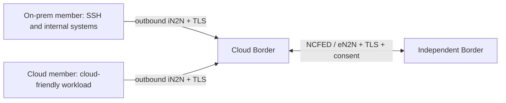

> **Deferred engineering draft — not rollout documentation.** R01 source is
> integrated for maintainer work only. General cloud deployment, version bumps,
> releases, Marketplace publication and deployment guides remain on hold until
> the full issue310 roadmap is complete, including users, SSO and RBAC.
> The owner-operated pilot is a qualification fixture, not a deployment template.

# Choose where your NetClaws run

NetClaw separates where a claw runs from what it is trusted to do. A Border
coordinates its members; each member keeps the credentials and tools needed to
reach its systems. Application identities stay stable when a reviewed endpoint moves.

| Deployment | Border reachability | Member placement | ngrok |
|---|---|---|---|
| Home or office Internet connection | A tunnel makes a Border behind NAT/CGNAT reachable from the Internet | Local or remote, connecting outbound | Retained option when direct inbound connectivity is unavailable |
| Cloud Border | Provider-reserved IP and reviewed TCP ingress | Cloud-friendly workloads in cloud; SSH, device and internal-system access on premises | Not required |
| Private on-premises | Stable private address reachable within the site or private network | On-premises members connect to their Border | Not required |
| Air-gapped site | Private Border and private member addresses, local trust and local services | Everything required to execute remains inside the disconnected environment | Not required; no public endpoint |
| Hybrid, multi-region or multi-cloud | Reviewed direct/private endpoints per Border and region | Place each workload near the systems it must reach | Optional per deployment, not a shared dependency |

The home configuration remains available. Moving a Border to cloud does not mean
moving device credentials, private network access or every member into cloud.
Cloud-friendly members can use cloud APIs or hosted services; members that need
local SSH, CML, private inventory or internal applications stay on premises.

Members initiate the connection and exchange work over the authenticated channel;
they do not need an inbound listener or an ngrok agent. Within one organization,
member-to-Border communication is **iN2N**. **NCFED/eN2N** federates independently
administered Borders with bilateral consent. Later same-organization Border
clustering has its own authority contract; Internet connectivity does not supply it.

Direct cloud transport uses separate iN2N and eN2N TCP ports. TLS terminates in
NetClaw, with explicit certificate name/CA, enrolled identities, revocation and
channel binding. Public IPs, DNS names, cloud accounts and ngrok tokens are not
application identities. Keep routing control, model servers, MCP, brokers,
gateway and admin APIs private. HUD ingress has its own review.

For an air-gapped deployment, provide local DNS or explicit private addresses,
local certificate trust, local models where required, and reachable local tools.
Stage source, runtimes, dependencies and updates through the site's approved
offline process. The normal installer and VS Code prerequisite checks contact
package registries; this guide does not claim a qualified offline installation
bundle or make hosted models/channels available without Internet access.

Use [direct transport setup](REMOTE-TRANSPORT.md) for cloud/private endpoints and
[optional ngrok setup](NGROK-TRANSPORT.md) for a Border behind NAT. `setup.sh` and
VS Code configure the selected host; they do not silently create cloud resources
or transfer an existing runtime. Separate runtime homes and credentials remain
mandatory. Cloud deployment, runtime relocation, recovery, multi-region and
multi-cloud qualification follow the [roadmap](../../../docs/roadmap/issue-310/README.md).

R01 implements the transport prerequisite. Check its
[verification](../verification.md) before treating
any topology or platform as live-qualified. Future roadmap entries are plans,
not claims of a completed deployment.
