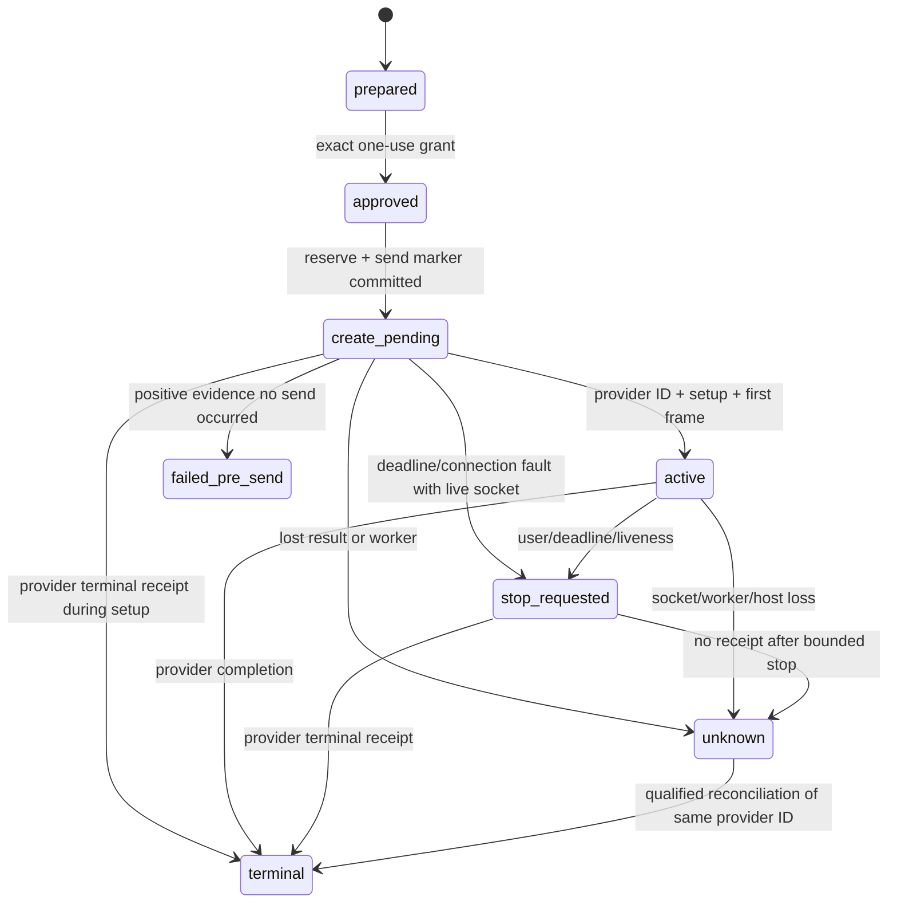

# Data model — Spec200

## Current accounting and acceptance contract — 2026-11-24

Implemented local model, version 1; not a Google schema. The private SQLite
campaign authority binds its canonical root, campaign and policy to immutable
operation-ID reservations. Integer USD microdollars avoid rounding admission
errors. The owner-approved production hard limit is US$100; US$25 is a review
checkpoint with continuation already authorized for all five recordings.

Each admitted operation reserves its full reviewed video/input/text bound before
provider create. An active or unknown provider outcome prevents new admission.
A confirmed original-provider terminal receipt permits distinct work only if
settled charges plus all retained full reservations plus the proposed bound fit
the campaign hard limit. Missing billing is never zero: terminal-but-unsettled
operations retain their full bounds. No changed key, world, root or restart
releases or bypasses a reservation. Settlement requires actual terminal and
billed-cost evidence. Original IDs never create a replacement world.

All six production sessions and the additional member qualification have terminal
receipts. Seven US$14.258688 bounds remain reserved (US$99.810816 total). Google
Cloud Monitoring reports video tokens, correlated by project/model/time window;
this is authentic usage evidence, not an interaction-ID receipt or final invoice.
Input/text and billed totals remain unavailable. No reservation is settled or
released. See [final qualification](final-qualification.md).

The owner accepted five recorded illustrations with documented visual/event
limits. Acceptance records preserve the original strict failures and the later
scope decision separately. Pixels remain illustrative; exact local facts and
source anchors are the factual authority.

JSON definitions: [contracts/schemas.json](contracts/schemas.json). Application
transactions enforce the semantic invariants below.

## Entities and ownership

| Entity | Required fields and relationships | Validation/meaning |
| --- | --- | --- |
| Observation | id,snapshot_id,device_ref,source,command,started_at,finished_at,outcome,parser_version,artifact_ref,sha256 | Local private identity only; exact allowlisted command; end>=start; source is actual tool/runtime identity. observed/empty/raw_only/parse_failed/timeout/unavailable distinct. |
| Snapshot | id,classification,window_start,window_end,selected_devices,observation_ids,coverage,created_at | <=4 frozen devices;8MiB evidence; private unless independently synthetic fixture. No secrets in normalized fields; source refs remain private. |
| Fact | id,snapshot_id,entity_ref,kind,value,observation_ids,source_paths,certainty | Every measured value references successful evidence/path. Missing value=null + unknown. Age derived from immutable time;5min staleness default. No invented percentage confidence. |
| Link | id,endpoints,evidence_ids,status,certainty | Status observed_up/observed_down/unknown/conflict; certainty corroborated/one_sided/unknown/fictional. No adjacency from common subnet/name/controller wiring. Unmatched neighbor remains unresolved endpoint. |
| SceneDraft | id,source_classification,snapshot_ref or synthetic_fixture_id,metaphor_version,structures,links,event | Classification taints all derivatives. Private classification is retained; hosting requires an operator-pinned exact minimized export grant. Fiction is declared, not measured. |
| Projection | id,classification,fixture_id,fixture_sha256,text,image_ref?,event_id,event_text,sha256 | Hosted admission permits registered independent synthetic fixtures or exact private-derived exports pinned by the operator to the registered snapshot manifest. <=4096 text characters; event<=512; optional1PNG/JPEG<=1MiB16:9 with stripped metadata, separately reviewed; first proof has no image. Hash covers exact outbound bytes and event policy. |
| ReviewGrant | id,projection_sha256,model,policy_sha256,account_scope,allowance_usd,currency,expires_at,consumed_by | Local human review authority creates it, not MCP/model arguments. One use,expiry10min; changed bytes/model/prices/event/limits invalidate it. No secret in record. |
| Session | operation_id,request_digest,installation_id,account_scope,projection_ref,grant_ref,state,send_marked_at,provider_id?,worker_identity,deadlines,reservation_id | One durable claim before provider create. Worker identity includes PID+start identity, never PID alone. Provider ID remains backend-local. State transitions below. |
| EventAttempt | event_id,operation_id,projection_sha256,state,sent_at?,observed_outcome,evidence_refs | One logical event and one send by default. planned/send_marked/sent/unknown distinct; no retry if uncertain. outcome pending/visible/inaccurate/not_visible/unassessed; send is not outcome. |
| UsageRecord | operation_id,estimated_usd,reported_usage?,billed_usd?,price_ref,settlement_state | Null not zero. settlement reserved/unsettled/reconciled. Terminal event may lack usage. CurrencyUSD; preserve provider token counters verbatim in private evidence. |
| AcceptanceRecord | operation_id,reviewer_ref,checkpoint_refs,navigation_seconds,event_latency_s?,drift_findings,terminal_ref?,usage_ref?,verdict | Zero to three observed checkpoints: baseline/post-navigation/post-event; all three required only for GO. Never fabricate a missing capture. Pass/fail/unassessed per criterion. GO/NO_GO/BLOCKED_LIVE, no automatic human verdict. |
| Artifact | opaque_ref,owner,classification,relative_owned_path,mime,size,sha256,created_at,retention | No caller path resolution; owned-root confinement/no symlinks. Binary/media not in MCP response. |

Scene/fixture identifiers are local UUIDs or fixed registry IDs. Hashes use
SHA-256 over canonical UTF-8 JSON (sorted keys, no insignificant whitespace)
plus hashes of exact image bytes; reject duplicate keys/nonfinite numbers.
Observation times use UTC RFC3339; local deadlines additionally use monotonic
clock. Wall-clock rollback cannot extend an active session. Restart without
continuous monotonic ownership never resets the prior budget/deadline.

## Session state machine

`failed_pre_send` requires affirmative evidence that transport was not invoked;
a timeout/HTTP5xx after send is not that evidence. Ambiguous create without an
ID stays unknown. `terminal` records provider status as received; it does not
mean fidelity passed, billing settled, or user accepted. A late terminal event
is append-only reconciliation of the same operation, never a replacement run.
A provider terminal error can settle effects while failing world acceptance.
Unknown cannot transition directly to approved/active/new operation.

For start, `operation_id` equals the caller's persisted `request_id` before any
transport. A lost start response is addressable through status using that same
UUID. Prepare/event/stop request IDs are separate from this operation identity.

Admission is a transaction: validate immutable grant/hash/account mapping,
ensure no active/unknown session and sufficient aggregate allowance including unsettled full bounds, consume grant, create reservation
and send marker. Commit before calling provider. No claim of distributed
exactly-once; possible sent-but-unobserved effects are explicitly held. Duplicate
operation+digest returns original; different digest with same ID is conflict.
Account scope is locally registered credential/account mapping; alternate key
names do not establish different accounts. If mappings are uncertain, share one
installation-wide hold. No multi-host use of the same account for this prototype.

Worker writes state/receipt to same private ledger even if MCP/manager dies.
SQLite transactions, busy bounds and startup reconciliation protect local
concurrency. GAIT records transition hashes/decisions, not secrets/raw configs.
If post-send audit fails, request stop and preserve ledger/evidence; never erase
an effect because audit failed. Start is refused if pre-send audit fails.

## Evidence, privacy and retention

- Raw collection <=8MiB; each call30s, whole collection180s,<=2 workers,<=4 devices.
  Timeout cancellation itself may be uncertain; preserve partial transcripts.
- World artifacts <=64MiB per session; individual JPEG<=2MiB, event log<=1MiB,
  <=2 frame decode queue. Overrun aborts recording and requests stop; do not call
  an incomplete recording complete. Keep bounded diagnostic metadata.
- Prefer canvas-stream MediaRecorder (actual browser codec support preflight)
  plus sampled frames and timestamps. No desktop/screen capture. Record exactly
  what the viewer displayed, including dropped-frame counts; no invented frames.
- Raw media retention7days by default; ledger/acceptance/usage/GAIT90days. Expiry
  schedules are not proof of deletion. Unknown/unsettled evidence is retained
  until reconciled and reviewed. Cleanup is explicit, confined to owned files.
- Source-controlled artifacts contain only synthetic data and sanitized results.
  Private identities, addresses, certificates, testbeds, tokens and credentials
  remain in local private stores; no absolute private source paths in tool output.
- First proof recording contains an independent synthetic scene only. The later
  five recordings use the separately authorized minimized private-derived export.

## Local graph and counter extension

DeviceFact and InterfaceFact retain stable selected-inventory identities across
render styles. NeighborObservation includes protocol,local interface,remote identity
claim,remote port,observed interval,expiry when known,and evidence references.
LinkFact binds two resolved interface IDs and supporting observations,with
one_sided/corroborated/conflicting/stale classification. Unresolved remote claims
remain visible as unknown endpoints rather than invented devices.

CounterSample is private:interface ID,incarnation marker,collection interval,
field name,integer value,units,width when known,and evidence digest/source path.
CounterRate references exactly two samples,elapsed time,continuity verdict,
value-or-null and a reason. CapacityFact supplies value/units/source for utilization.
WorldStyle selects realistic or fantasy for the provider scene instructions.
It is presentation intent, not measured evidence. Each style has its own exact
projection hash, reviewed session and acceptance record. Local scene geometry is
retired; local fact identity and provenance remain authoritative. Five implemented style projections are source- and snapshot-bound before admission.

## Routed-lab evidence archive and bounded projection

The owner expanded the local lab to OSPF, iBGP, router-on-stick and VLAN/STP,
then requested a saved snapshot so generation would not depend on live systems.
The sealed archive retains the entities below. Offline import verifies every
manifested file and the pinned snapshot identity. Projection accepts only the
supported sourced VLAN and established OSPF/iBGP cues; other archived entities
remain local evidence, not invented visual facts. The six-read live collector
does not automatically acquire this broader command catalog.

| Entity | Required evidence | Meaning and uncertainty |
| --- | --- | --- |
| RoutingAdjacencyFact | Protocol, device/interface or loopback identities, peer identity, process/area or AS/address-family, observed state, interval, source paths and observation IDs | OSPF FULL and BGP Established are observed control-plane states. BGP peering is a logical relationship; neither creates a physical cable edge. |
| RouteFact | Device, VRF/address-family, prefix, protocol, next hop, preference/metric when supplied, installed/best-path state, observation IDs | Advertised, accepted, BGP-best and installed-in-RIB are separate facts. Route presence alone does not prove forwarding or host reachability. |
| VlanPortFact | Interface identity, VLAN/tag, configured and operational mode, native/allowed/active/forwarding sets, observation IDs | Router subinterface, trunk membership and access membership are distinct relationships. Missing or conflicting sets remain unknown/conflicting. |
| SpanningTreeFact | Device, mode, VLAN/instance, root/bridge identities, priority, interface role/state, configured protections, observation IDs | Root/forwarding observations and configured PortFast/BPDU Guard are separate. A configured guard does not prove a fault-injection test occurred. |
| EndpointObservation | Observed IP/MAC/VLAN/port claim, source command, interval, evidence ID; optional separately evidenced CML lifecycle and probe result | Controller wiring/bootstrap, link carrier, MAC learning, ARP and successful ping each establish different facts. A stopped host is never marked reachable from a switch port alone. |

All remain private with the existing fact provenance and staleness rules. A later
reviewed projection can illustrate physical links, VLAN segments, OSPF underlay
and iBGP overlay as distinct visual layers. Generated packets, motion or event
effects are fiction and never update measured protocol/route/device state.

## Implemented foundation records

The owner registry binds an opaque snapshot ref to an absolute private bundle
path and a trusted SHA256 manifest pin. It is never an MCP argument. The offline
reader verifies every manifested file, ownership/permissions, missing/additional
files, symlinks and total bounds before exposing local facts. Historical baseline
and later enrichment windows remain distinct; unavailable is never zero/healthy.

`drafts` shares the session SQLite database: immutable request UUID, payload
hash, generated opaque projection UUID and bounded classification/summary.
Private drafts remain hosted-ineligible. Five local style records share the
snapshot pin, retain source anchors/coverage and have distinct exact outbound
hashes. `generated:false` and `export_authorized:false` are not rewritten by a
style choice. Raw config, credentials, IP addresses and counters stay out of the
candidate outbound text.

Draft interaction guidance follows the actual optional outbound event: linked
drafts describe one text event; zero-link drafts explicitly report that no text
event is prepared. Local fact inspection remains separate from provider controls.
This metadata does not authorize export or alter the outbound hash (pass43).

VLAN and logical-protocol projection claims require a valid source SHA256 and
no explicit non-observed outcome/status on either record or source. Historical
sealed records without outcome fields still require supported parsed evidence.
VLAN cues retain bounded enumerated membership, exclude the native VLAN and keep
local source anchors; omitted/failed records remain in local facts and coverage.
This eligibility check neither grants export nor mutates the snapshot (pass45).

`controls` shares that database: request UUID, payload hash, operation UUID,
action and pending/accepted/refused/unknown handling result. At most32 records
per operation are exposed; duplicates retain their original identity and changed
payloads conflict. The session's event marker independently deduplicates the
fictional effect across browser/MCP. A control ACK is not a visible event,
terminal receipt or reconciled usage. Pending controls on worker exit or manager
restart become unknown without replay. Status/evidence are observational only.

`mcp-control.json` is a private capability file distinct from owner/bootstrap
credentials. It grants the six control routes and excludes review creation,
private fact routes and viewer WebSockets. The wrapper cannot import arbitrary
files, select a model/provider or expand the source/price policy.

## World-suite pass02 admission seam — source only

A campaign-bound Session stores `campaign_reservation` containing the session
binding SHA256, integer `bound_microusd` and original reviewed-packet digest.
The binding hashes canonical session root and the exact existing ledger request
digest. Campaign reservation commits before the session marker transaction;
rollback never releases it. A settled reservation can only retrieve its existing
session, never recreate a missing marker. Runtime launcher/packet pinning and
artifact verification remain open; historical session USD fields/policy are not
yet migrated. This seam does not establish service-enforced120s exposure.

## World-suite pass03 trusted launch binding

Operator-only environment pins an exact private binding file by SHA256; it carries
schema1, campaign_id, authority_root, authority_dev, authority_ino and policy_sha256.
The root must be canonical; database identity/ownership and stored campaign/policy
binding are verified without initialization. Live packets carry only the matching
campaign_authority_sha256, never an alternative authority selector. New database
identity requires a new coordinator review; copying state does not preserve the
pin. Source and policy changes invalidate their corresponding reviews. The manager
passes pin configuration to its worker. This is authority validation only: actual
CampaignAdmission routing and service/input-text/billing evidence checks are open.

## World-suite pass04 reviewed artifact reference

Closed source seam: `{path, sha256, dev, ino, size_bytes}`. Absolute private path,
SHA256 of exact bytes, safe integer device/inode and exact length; regular owned
single-link file, no symlink traversal, positive size at most1MiB. Fixed-size
file-descriptor reads check before/after metadata and final path identity.
Byte-identical replacement needs a new review. Existing private packet/authority/
credential loading shares the bounded reader. No new MCP argument is exposed.
Typed review/service/input-text schemas and admission consumption remain open;
verified bytes do not establish the truth of cost, duration or billing claims.

## World-suite pass05 typed cost records — source seam only

loadCampaignReview takes a trusted exact review artifact reference and backend
context (world_number, source_files, synthetic projection); reloads the operator
campaign pin; revalidates current source bytes. Every typed record requires schema1,
kind, campaign_id/campaign_authority_sha256, source_manifest_sha256,
projection_sha256, policy_sha256, model=genie-4, currency=USD, world_number and
 target_seconds=120. Source manifest digest is canonical hash(source_files).
Typed bytes must match compact JSON.stringify encoding, rejecting duplicate keys.

campaign_review additionally holds expires_at, reservation_microusd and exact
service_bound/input_text_bound artifact references. service_bound requires
provider enforcement, max_seconds=120, video_bound_microusd=12096000 and an exact
evidence artifact. input_text_bound requires provider enforcement, positive safe
integer max_input_tokens/max_output_text_tokens, input_price_microusd_per_million,
output_text_price_microusd_per_million, bound_microusd and exact evidence artifact.
The input/text allowance must cover both independently rounded-up token charges;
BigInt prevents product overflow. Reservation equals video plus input/text, within
soft stop. Shared campaign aggregate enforcement remains CampaignBudget's job.

These are coordinator-reviewed claims, never self-authenticating provider proof.
The coordinator must assess actual caps/prices and pin the review reference in
trusted launch configuration. No runtime tool exposes this seam; real request
limit enforcement and admission/lifecycle wiring remain open. Returning valid
budget_review fields alone grants no provider call or private projection export.

## World-suite pass06 pinned review admission seam

Operator-only NETCLAW_GENIE_CAMPAIGN_REVIEW and matching _SHA256 pin exact
compact JSON launch bytes: schema1, world_number, source_files and review artifact
reference. admitReviewedCampaign accepts only operation_id, projection, review_id
and optional projection_ref; all campaign review fields derive from that pinned
descriptor and its validated retained evidence. Every admission rechecks bytes,
source closure, projection and authority before shared reservation/session-marker
transactions. No implicit authority initialization or model-supplied review.
Live manager wiring and120s ledger policy migration remain open; historical USD
fields are unchanged and must not be interpreted as campaign-bound estimates.

## World-suite pass07 explicit campaign record policy

New campaign markers add `accounting_version: campaign-v1`, `session_policy`
(target120s, deadline130s from send, terminal wait5s), `reserved_microusd` and
`estimated_video_usd: 12.096`. USD reservation and conservative total estimate
both derive from the complete reviewed integer bound. These describe an admitted
record, not actual runtime/provider enforcement. Existing records are never
backfilled on open or original-ID retrieval. Manager/worker integration must
explicitly validate the policy and reject legacy records for new campaign sends;
ordinary admission and historical POLICY remain unchanged in this source unit.

## World-suite pass08 worker policy selection

sessionPolicy(record) requires explicit campaign-v1, exact CAMPAIGN_SESSION_POLICY,
matching integer and USD reservation/estimate fields, and valid bounded deadline
for Google worker sends. Historical records remain retrievable but cannot silently
acquire120s execution. Fixture records use historical POLICY; accelerated worker
clocks are fixture-only. Before opening transport the worker rereads and compares
its entire record, requiring create_pending/reserved with no provider ID. This is
record consistency, not trusted campaign review validation; manager/local-review/
live-packet migration and provider-boundary authority enforcement remain open.

## World-suite pass09 direct provider validation

validateReviewedCampaignSend reloads the pinned campaign launch/review, complete
source closure and evidence references, then checks the existing reservation by
original operation ID and session root/request digest. assertReserved is a lookup,
never an admission: missing, changed or settled rows refuse without repair. It
requires reserved/create_pending, explicit campaign policy, unexpired send deadline,
matching synthetic projection and no provider ID. openGoogle runs this before SDK
create, including injected clients. Ordinary ledger lookup remains unchanged.
This validates retained claims; actual service/input-text bounds and reconciliation
still need coordinator evidence. Manager review/pin wiring remains unqualified.

## World-suite pass10 explicit local campaign reviews

Ledger.review now accepts the exact CAMPAIGN_SESSION_POLICY for Google only,
recording accounting_version=campaign-v1 and reservation_microusd alongside the
120s policy hash and derived USD allowance. Positive input/text headroom above
12,096,000 microUSD, the25,000,000 soft ceiling and exact microdollar precision
are required. Historical POLICY and fixture reviews retain their existing shape.

New campaign admission requires that explicit local policy/version before shared
reservation. Ordinary admission cannot downgrade a campaign review. The returned
reservation must exactly match the reviewed integer and USD amounts; null results
refuse. A mismatch after reservation rolls back the local marker/review consumption
but preserves the campaign hold for reconciliation. Original-ID lookup precedes
new-review checks and never rewrites historical review/session bytes. The legacy
request-digest encoding stays stable; the review ID and retained campaign review
hash bind the versioned policy and amount independently.

Manager and live packet migration remain open. This local review is not operator
export/spend authority or proof of provider caps; pinned campaign evidence remains
required at admission and provider send.

## World-suite pass11 versioned live packet

Schema2 uses the existing packet fields with policy_sha256 bound to
CAMPAIGN_SESSION_POLICY, plus world_number, reservation_microusd and
campaign_review_sha256. The last is the exact review artifact hash; the operator
launch descriptor remains separately pinned by environment. reservation_microusd
must equal the typed service video bound plus input/text bound; allowance_usd
must equal that integer divided by1,000,000. Both source manifests validate against
current closure. All pinned review/evidence checks precede credential loading.
Schema1 keeps historical POLICY and15USD semantics without rewriting stored bytes.
Packet validation creates no reservation/session and does not prove service bounds.
Manager review/admission and frozen four-pin propagation remain outstanding.

## World-suite pass12 manager campaign routing

Live manager startup requires schema2 and freezes the four operator authority and
review launch pins; workers receive only those plus PATH. Local review/draft
policy is CAMPAIGN_SESSION_POLICY with exact packet allowance. New admission
reloads the packet/source/evidence after native audit awaits, requires the same
startup packet digest, then uses admitReviewedCampaign. Original-ID lookup uses
the historical request digest without new authority, mutation or worker creation.
This is source qualification only; service caps and durable transport ownership
remain separate. No historical record is migrated or campaign hold released.

## World-suite pass13 durable provider transport claim

`provider_creates(operation_id PRIMARY KEY, claimed_at)` is an additive table in
the private session SQLite ledger. A BEGIN IMMEDIATE transaction compares the
fresh session with the just-validated record, checks pending/reserved/no-provider-ID
and deadline, then inserts one permanent claim with its audit entry before SDK
create. Duplicate or reopened callers refuse; no asynchronous gap precedes the
claim. This does not provide distributed exactly-once delivery or recover an ID
lost before persistence. A claimed create cannot transition to failed_pre_send.
Create rejection, missing ID or connect rejection leaves unknown and retains the
claim, known original ID and full separate campaign reservation. No retry/release
API is added. Native process-death and late-result lifecycle qualification remain
open.97/97 affected source checks pass; no provider acceptance is implied.

## World-suite pass14 in-flight ledger lifetime

An adapter holds one in-process ledger reference from its committed create claim
through create/connect settlement, releasing it in finally. Ledger close requests
physical close after the last outstanding reference; new references after close
are refused. This retains an observed original provider ID/error when local
worker cleanup precedes callback completion, without recreating a database or
releasing reservations. Unknown remains unknown and late cancellation is only
best effort. The lease cannot survive process.exit/host death; bounded CLI drain
and actual provider termination/billing remain open qualification gates.

## World-suite pass15 native worker drain

After local worker completion, the CLI retains pending original-open and cleanup
promises for a fixed maximum five seconds. A late original response can persist
its ID and trigger one cancellation; setup/media remain disabled. It records
`worker_shutdown_drain` with `drained` or `deadline` before ledger close/process
exit. Neither result means provider termination or billing reconciliation. Pending
create/cancel at expiry retains unknown, the durable claim and full reservation.
This is a local process grace, not durable transport resumption. Manager's current
6.5-second shutdown grace can still preempt it; that composition remains open.

## World-suite pass16 manager/worker shutdown composition

Shared model constants bind the five-second worker drain to manager grace:
max(fixture terminal wait, campaign terminal wait) + drain +1.5s scheduling margin,
currently11.5s. Manager measures its grace monotonically; workers still use their
original session deadlines. After grace expiry, it marks nonterminal rows unknown
and reaps only owned children before closing the ledger/removing its lock. A late
original ID can persist during the drain, but no unknown/reservation is cleared.
No new module, record migration, provider receipt or settlement authority is added.
This supersedes the6.5s limitation above; in-flight admission during manager close
is a separate remaining source qualification gap.

## World-suite pass17 shutdown admission ownership

Closing is a process-local admission barrier, checked before a new admission audit
and after its await, prior to reservation/send marking. Refused admission returns
503 manager_closing. Original-ID retrieval remains observational during worker
drain. Admission audit promises are tracked alongside outcome audits, including
when their HTTP peer disconnects; shutdown retains ledger and lock until they
settle. Every close caller shares one promise through final unlock. No persisted
schema or campaign authority change; no provider termination/settlement implied.

## World-suite pass18 HTTP shutdown ownership

After worker drain/reap, owned HTTP sockets receive one second to finish before
forced closure; this includes incomplete headers and WebSocket upgrades. Each
request handler owns a completion promise until its finalizer runs. SQLite and
manager.lock remain owned until both handlers and pending audits settle, even
if the client has disconnected. Aborted recording body reads retain a recording
failure before close; complete uploads retain their bytes. This is not a provider
receipt, settlement, or total bound on an externally stalled audit. No persisted
schema, source module or campaign authority is added.

## World-suite pass19 browser final-flush boundary

The one-second HTTP grace keeps the listener accepting new authenticated evidence
connections after stream closure, because MediaRecorder flush is asynchronous.
Admission remains closed. After expiry, listener/sockets close, then pending
handlers/audits release the ledger. Actual Chrome qualifies0/250ms final uploads
and visible1250ms failure, not arbitrary browser scheduling. There is no durable
final-flush acknowledgement yet; nonempty media plus provider terminal state must
not be interpreted as complete capture. Missing-final evidence remains open.

## World-suite pass20 recording final-flush evidence

Additive recording_receipts stores one immutable JSON receipt per operation:
size_bytes, sha256 and at. Authenticated viewer POST recording-final accepts only
size_bytes, checks nonempty bounded media, fsyncs it, then commits receipt/audit.
Same receipt is idempotent; later chunk writes and conflicting receipts are refused.
Evidence recording state is final_flush_acknowledged only with matching artifacts
and no recorded failure; absent receipt is unconfirmed/final_flush_unconfirmed,
including legacy sessions and restart. Failure or artifact mismatch is incomplete
without deleting prior receipt. This proves final-flush persistence only, never
provider termination, usage settlement, content fidelity or world acceptance.

## World-suite pass21 recording acknowledgement recovery

The viewer distinguishes lost finalization responses from failed chunk uploads.
After one failed recording-final request it makes one bounded, read-only evidence
request for the same operation; a matching acknowledged receipt recovers local
confirmation. If unavailable, the UI reports final confirmation unavailable and
preserves the server record without inventing a recording failure. No chunk,
finalization, provider create or event is replayed. Genuine upload/recorder failures
still persist as incomplete. Existing backend shutdown bounds are unchanged.
A killed browser before onstop leaves any saved media unconfirmed after restart.
Neither a receipt nor recovery establishes navigation, drift or world acceptance.

## World-suite pass27 event checkpoint receipt

Additive `event_checkpoints(operation_id PRIMARY KEY, body)` stores the immutable
original event/frame/capture receipt described in contracts/control.md. Its audit
entry commits in the same SQLite transaction. JPEG sync precedes the transaction;
partial file-only capture remains unconfirmed. Source-frame and recompressed
capture hashes have separate meanings. The 256-frame in-memory provenance window
is never recreated after manager restart; durable receipts remain readable.
