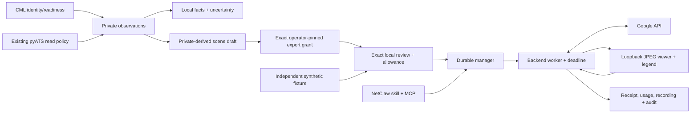

> **Current integration status — 2026-11-24:** 30/30 tasks complete for the owner-accepted Mac recorded-illustration scope. Actual selected-runtime collection passed 24/24 reads; the existing Border-owned member completed a real Google lifecycle through its skill and MCP. Google reported video usage for all seven runs; all US$99.810816 reservations remain held because final billing is unavailable. The five accepted recorded illustrations are unchanged. Local regression and handoff are complete; hosted CI must pass before the authorized merge. See [final-qualification.md](final-qualification.md). Older checkpoints below are historical, not current authority.

# Implementation Plan: Genie-to-Genie network worlds

**Branch**: `200-genie-network-worlds` | **Date**: 2026-11-22 | **Spec**: [spec.md](spec.md)
**Input**: `/Users/john.capobianco/netclaw-spec200-genie/specs/200-genie-network-worlds/spec.md`
**Stage**: Five recordings and actual collector/Border/member/Google qualification complete; local qualification complete; hosted CI and authorized merge pending.

## Summary

Generate five owner-authorized network-world treatments using Google Genie 4 through
the Gemini API: technical blueprint, living fantasy, network city, packet-scale
machinery and realistic future data center. The owner later authorized all five recorded styles after the first two captures; their fidelity limits remain visible. Cisco pyATS Genie supplies local measured facts and provenance. The
first hosted proof uses an independent synthetic scenario; a real-data projection
requires exact privacy review. The local-renderer alternative is retired. Build the smallest official API backend and its narrow stdio MCP/skill foundation
before world refinement, following the latest owner instruction. The MCP and
source skill now exist; Google's API remains the execution backend. Actual
provider and member acceptance require separate observed proof.

Choose a backend-owned WebSocket session worker, loopback browser viewer and
durable local ledger. Relay JPEG frames to browser Canvas. No media server,
cloud VM, extra image model or HUD integration is needed for direct provider
qualification. The existing Border owns and routes the scoped Genie member in its Risk; the backend retains independent session ownership. Text-only
input is the first experiment. A deterministic local reference image is a
possible later refinement, not another subscription or required dependency.

## Technical Context

**Language/Version**: JavaScript ESM on repository-supported Node >=24.19 <25 or >=26.1; isolated Python3.12 for existing pyATS/Genie and the official MCP2.3.0 wrapper.
**Primary Dependencies**: Isolated @google/genai3.6.1 worker package; existing ws8.x, Node HTTP and browser Canvas. Separate wrapper package using the repository-qualified official MCP SDK; no React/FastAPI/media service.
**Storage**: Private owner-scoped SQLite ledger and bounded artifacts,0700 directories/0600 files; existing GAIT. Reuse qualified private atomic-write/ownership conventions, not federation authority tables.
**Testing**: Node test runner; offline Genie parser samples/Python unittest; actual local browser and process fault drills; separately gated Google and native NetClaw qualification.
**Target Platform**: This Mac, supported Node and desktop Chromium first. Linux, Windows/WSL and mobile remain unqualified.
**Project Type**: Local experimental tool, browser viewer, stdio MCP control wrapper and skill.
**Performance Goals**: Local stop/status visible within1s; <=10Hz movement key-down input; <=2 queued frames;10s first-frame deadline; campaign completion requested by130s from create send or120s from first frame; initial no-frame deadline10s.
**Constraints**: One hosted attempt active or unknown per selected account/installation; independent synthetic first, then exact owner-approved minimized projections; no secret in browser/tool output; no automatic create/event replay; no device writes.
**Scale/Scope**: Four devices and three physical links from a sealed snapshot; separately catalogued152-request capture with explicit gaps. Initial hosted qualification is synthetic. Five scene styles share the same measured facts after exact export review; all five recordings are explicitly authorized. At most50fresh-context passes,10perworld, after foundation readiness. One session at a time,120s campaign target,10s navigation,one fictional event and human review. All50source passes are complete and stopped.

## Constitution Check

Pre-research and post-design checks pass for this planning scope with the
explicit standalone-proof exception below. Live/integration gates stay open.

| Principles | Application |
| --- | --- |
| I–III,VIII | Read-only collection; no CML lifecycle/device configuration. Any later real change retains its own change control. |
| IV | Native GAIT session; future intent/send/terminal/unknown evidence is audited. Ledger controls effects. Admission fails if audit cannot be prepared. |
| V,VII,XII | Worker is an internal dependency; the six-tool MCP and source skill now reuse it. Latest owner steering puts foundation source first; live/member acceptance remains required. |
| VI,IX,XIII | Cisco parsing remains in its selected runtime. Least privilege, private credentials, synthetic first, exact pinned private-derived export exceptions only; no raw upload. |
| X,XI | Terminal/VS Code setup, catalog and HUD capability status are implemented. Embedded world players remain out of scope; the coherence matrix still governs merge. |
| XIV,XVII | Owner authorized version preparation and PR/merge after100% completion; no unrelated external announcement or WordPress publication. |
| XV | New dependencies isolated; existing homes/testbeds/SSH trust untouched; experimental feature defaults disabled. |
| XVI | Existing spec → plan → subsequent tasks/analyze → implementation. Tasks/analyze completed; subsequent owner instruction started implementation. |

## Project Structure

Implemented source paths (installation and live qualification remain separate):

```text
specs/200-genie-network-worlds/
  spec.md  plan.md  research.md  data-model.md  quickstart.md
  contracts/{provider.md,control.md,schemas.json}
  contracts/netclaw-genie-worlds/SKILL.md
  checklists/{requirements.md,quality.md}
  verification.md  resume.md  next-session-prompt.md
scripts/genie-worlds/
  cli.mjs  manager.mjs  worker.mjs  ledger.mjs  provider.mjs
  viewer/{index.html,viewer.mjs,viewer.css}
  fixtures/synthetic-museum-v1.json
mcp-servers/genie-worlds-mcp/{server.py,requirements.txt,README.md}
workspace/skills/netclaw-genie-worlds/SKILL.md
tests/genie-worlds/
```

Reuse managed pyATS runtime selection, `scripts/lib/pyats_session.py`,
`scripts/lib/pyats_testbeds.py`, private-file patterns and native GAIT tools.
Review Tavus and Hermes request-ledger patterns for ownership/unknown outcomes;
do not import their provider policies or start unrelated runtimes. Smoke-test
Node's SQLite API on the selected supported runtime before choosing its exact
import. No ORM or server database. Keep Google's optional MCP peer dependency
out of the wrapper's dependency closure.

## Architecture and boundaries



Registered independent synthetic fixtures qualify the first hosted path. An exact
operator-pinned grant may authorize a private-derived projection matching the
registered snapshot manifest; private classification remains. Tools cannot choose
a path, arbitrary prompt or export approval. Raw facts remain behind owner access.
No browser microphone, camera or display-capture permission.

## Phase 0 — research

Complete in [research.md](research.md): API, SDK, media, termination semantics,
pricing, collector commands/parser behavior, privacy and alternatives. All
design choices are resolved. Entitlement, actual runtime behavior and fidelity
are explicit evidence gates, not missing design placeholders.

## Phase 1 — design and contracts

Complete in [data-model.md](data-model.md), [control contract](contracts/control.md),
[provider contract](contracts/provider.md), [schemas](contracts/schemas.json),
[proposed skill](contracts/netclaw-genie-worlds/SKILL.md) and [quickstart](quickstart.md).
Local proposed names are distinct from Google's actual API names.

### Observation pipeline

1. Select isolated Python3.12/pyATS and exact private inventory. Authenticate
   CML read-only for identity/state; booted is not a health verdict.
2. Freeze <=4 identities/endpoints and saved trust pins. Use a process-local
   testbed; no default repairs or console-to-SSH inference.
3. Collect `show version`, `show ip interface brief`, and
   `show lldp neighbors detail` per selected IOS-XE device within FR-014 bounds.
   CDP is an explicitly selected alternative, not an automatic fourth read.
4. Preserve raw evidence; normalize allowlisted parser fields/source paths.
   Installed upstream executes again on parser failure. Qualify execute-once,
   capture, offline parse inside the existing read policy before claiming a
   strict command bound. No bypass of a denied tool through raw SSH.
5. Match links from neighbor identities/endpoints, not display names. Both ends
   support corroborated links; one-sided/conflicting results remain labeled.
   Unknown endpoints stay unresolved. Controller wiring is separate provenance.
6. Render local facts with observation intervals, age and five-minute staleness.
   Normalize control characters, cap labels128 characters, render as text and
   never interpolate device strings into commands, prompts, HTML or paths.

### Session lifecycle, budget and failure

Before create: validate the exact projection/model/event/prices/source and reserve
the reviewed maximum. The authorized production campaign uses120seconds per
session, US$100 hard aggregate and US$25 review checkpoint. Each retained
reservation is US$14.258688: US$12.096 video plus conservative input/text bounds.
Six sessions total US$85.552128; usage remains unreported. These are reservations,
not actual billed spend or provider spending caps. Historical20second/US$15 and
US$50 packets are not current authority and cannot be replayed. A future campaign
requires its own exact review and sufficient aggregate allowance.

A separate worker owns one provider WebSocket and one receive iterator,
independent of MCP/browser lifetime. Its socket cannot be recreated after
crash by assuming resumption. Start monotonic deadline before send; request
completion at earlier of130s since send or120s since first frame for the campaign. The legacy fixture policy remains20s/30s. No frame by10s
triggers stop. Viewer heartbeat1s, loss3s triggers stop; manager heartbeat
expiry5s triggers stop. MCP disconnect alone leaves a healthy viewer's original
bounded session running. Browser blur releases movement keys.

Persist stop intent, release keys, reject new controls, call `complete()` and
keep receiving. Wait5s for provider terminal event, then best-effort `cancel()`
once. Without a terminal receipt mark unknown. Successful method return or
socket closure proves no server stop. Worker/host/upstream loss after send
retains an account-wide unresolved hold. GET reconciliation is allowed only
after qualification of live semantics; generic background REST cancel is not
an independent live kill switch.120s documented expiry never replaces a receipt.

Estimate, provider usage and billed cost are separate. Missing usage is unknown,
not zero. Only reconciled usage releases a reservation. A confirmed terminal receipt permits distinct admission while the entire previous bound still counts against the aggregate cap. Time passing
never turns unknown into success; a recovered receipt settles the original ID.
No agent-facing force-clear operation or reset through another ID/account alias.

### Viewer and fictional event

Loopback HTTP/local WebSocket with exact Host/Origin checks, one-use bootstrap
capability and no CORS wildcard, query-string secret or third-party scripts.
Capability stays in browser memory; no localStorage/provider token. Relay JPEG
binary with sequence/time, <=2 queued frames, dropping late decode. Audio is
off for first proof. Local facts stay readable if video fails.

Allowlisted movement key-down <=10Hz; key-up/release-all bypass rate limiting.
A rate violation releases keys and stops; deduplicate held keys and release on
stop/blur/loss. One fixed lighting event is available once, through viewer or MCP under
the same event ID,after a2s one-use operator target-visible flag from the viewer. The real-world campaign reviewed one semantic event as ten identical text impulses150ms apart; the independent synthetic trial used one send. A partial or uncertain burst is never replayed. Preserve intent/send/visible outcome independently.

## Phase 2 — next implementation sequence

| Order | Deliverable/dependency | Exit evidence |
| --- | --- | --- |
| P0 | Generate Spec Kit tasks; analyze consistency | Gates retained; no unresolved requirement conflict |
| P1 | Offline fixture, projection boundary, ledger/worker, viewer | Meaningful privacy/effects/fault tests; no provider calls |
| P2 | Qualified collector under existing read policy | Actual bounded observations, parser provenance, uncertainty |
| P3 | Provider adapter/contract fixtures, exact live packet | Entitlement, allowance and terminal/usage semantics explicit |
| P4 | Actual synthetic world/navigation/event/termination/review | Video and fixed rubric; failed evidence preserved |
| P5 | Thin MCP + skill in an isolated member of the selected Risk; source preparation now precedes P4 | Actual member skill/tool/worker/session correlation; source-only proof is insufficient |
| P6 | Fault drills, coherence and owner go/no-go | All applicable success criteria and live gates closed |

P1/P2 can proceed independently after task generation. Following the owner's
request for an immediate synthetic sample,P4 depends on P1 and provider/readiness
parts of P3;P2 remains mandatory for measured-facts acceptance,not synthetic media.
P5 reuses the worker. Its paid native-agent world needs a separate allowance
unless explicitly included in the live packet; P4 alone does not prove agent
integration. Exercise native offline controls before another paid attempt.

### Meaningful verification

- Private/mislabeled derivatives refused; untrusted strings inert; no secrets
  in logs/recordings/tools; no arbitrary paths/URLs; Host/Origin/capability checks.
- Concurrent duplicate starts cause one send. Distinguish crash before send,
  after send and ID-loss. Assert retries disabled below adapter and account-wide
  unknown holds survive new IDs/processes.
- Delayed frame, slow consumer, tab/MCP/manager/worker exit, network/host loss,
  late receipt, missing usage and rejected stop: assert evidence/effect counts.
- Parser failure cannot hide another read. Empty/partial/raw-only/conflicting
  neighbor outcomes retain meaning; deadlines/byte/device bounds enforced.
- Native browser JPEG playback, key release, readable legend, responsive stop,
  bounded recording and correct frame ordering.
- Real world:10s movement, one visible event, three-checkpoint drift rubric,
  provider terminal/usage and human review. Fixtures do not qualify Google
  outage behavior; live failure drills require separately budgeted attempts.

## Fresh NetClaw qualification

Prepare a fresh scoped `genie-worlds` member for the owner's existing Risk,
with its own workspace/state/GAIT and only the six world-control tools. Use the
existing Spec184 member-spec/setup/enrollment path and qualified pinned runtime
closures. Do not create a new Border, adopt an owner's home, revive old roadmap
runtimes or copy a whole dotenv. The canonical member spec validates; its exact
Risk home and agent provider/model credential reference remain unselected.
See native-review.md for the concrete local setup review and observed gaps.

Default Node25 is unsuitable; select supported Node explicitly. Python3.12 runs
the isolated MCP2.3.0 server. The member gets its own backend control-capability
path, never the owner/bootstrap capability, raw snapshot or Google key. Collection
is already frozen and independent; do not grant CML/SSH/pyATS to this member.

Installed → MCP discovery → deterministic calls → actual agent skill/tool use →
actual Google world are separate proof levels. The first three local-control
steps have source/stdio/browser evidence; an actual member/skill turn and Risk
enrollment remain open. Hosted-agent qualification uses synthetic metadata;
private facts stay in the local owner inspector. Exact private-derived projection
export is a separate reviewed capability after the synthetic usefulness proof.

## Product impact and coherence

| Surface | First proof | Before distributing integration |
| --- | --- | --- |
| HUD | No change; standalone viewer | Capability/status node and launcher after useful proof; no embedded stream assumed |
| VS Code | No command/form/bundle changes | Catalog discovery if applicable; qualify any later native changes separately |
| Mobile | No change; desktop proof | Touch/stream interaction separately scoped; no mobile qualification claim |
| Installer/config | No registration | Optional canonical component, isolated dependency closure, selected-home env references, disabled by default; coverage check |
| Skill/docs | Proposed contracts only | Skill/server README, SOUL/TOOLS/.env.example, accurate README counts and setup together |
| Release | Held | No merge/version/package/blog/publication authorization here |

## Complexity Tracking

| Scoped exception | Why needed | Simpler alternative rejected because |
| --- | --- | --- |
| Standalone proof before MCP/HUD coherence | Explicit owner direction | Building all clients before utility is demonstrated expands scope without acceptance evidence |
| Separate worker | Own deadline/socket/receipt across client loss | Browser session with unqualified REST cancel cannot establish backend control |

Full coherence is a later integration gate, not waived. No new framework,
cloud service, federation authority or image-generation subscription.

## Corrected world delivery and measured scene preparation

[Owner correction](direction-correction.md) supersedes the local SVG/3D renderer.
The standalone browser displays actual Google-generated media. Required styles
are realistic network equipment and fantasy network architecture; qualify each
with navigation, a fictional event, drift checkpoints and terminal/usage evidence.
The first exact paid packet selects a synthetic realistic scene. A second fantasy
session needs its own reviewed projection and allowance. Keep the SDK worker,
credential isolation, ledger and provenance pipeline; remove local scene geometry.

Retain the six-read detailed profile and local normalized evidence. Rates require
valid sample timing and continuity; generated movement cannot supply missing facts.
A later real-lab world needs an exact approved topology projection; private raw data
and configuration stay local. First hosted qualification remains synthetic.

## Bounded fresh-context execution — owner authorization

The owner requested at most32sequential Ralph passes toward all30tasks,including
precise,creative and walkthrough quality. scripts/genie-worlds/ralph-runner.py
starts a new codex exec --ephemeral process for each pass;it does not resume a
conversation. The identical loops/PROMPT.md plus durable HANDOFF/pass notes/tasks
supply context. No parallel writers,nested loops or automatic source commits.
The private state counter survives restart and cannot reset the32pass allowance.
Source work,focused verification and actual visual review rotate according to
remaining dependencies. The local-renderer scope recorded in those loops was rejected by the owner.
It is historical evidence only; direction-correction.md defines current acceptance.

A pass timeout/crash needs review;three blocked passes without independent work
stop rather than consuming the entire budget. All30tasks plus actual owner
acceptance are required for completion;the runner never treats a promise phrase
or iteration count as proof. Paid generation remains pending the existing exact
US$15question;32model passes does not authorize32Google sessions. Original198,
reserved199,private-data boundary and publication holds remain unchanged.


Owner routed-lab expansion: see [complete collection/verification command table](collection-commands.md). The six-read source profile is not silently broadened by this document.

### Routed-lab preparation and later collector extension

The explicit owner network request was executed separately through API-owned
Local/Lab records, baseline/rollback artifacts and native configuration tools.
See [actual qualification](routed-lab-qualification.md). The product collector
remains read-only and cannot acquire write authority through this preparation.

The owner's later save-and-reuse instruction is implemented by the sealed routed
snapshot and `offline-snapshot.mjs` hash/ownership validation. `world-designs.mjs`
admits only supported sourced VLAN and established OSPF/iBGP cues. The full command
archive remains private evidence; it is not a broader live collector profile.
T016/T019 now qualify capture-once, durable request recovery and the closed
observation envelope for the initial/detailed profiles. Controller bootstrap,
interface state, physical discovery, routing, VLAN/STP and active probes remain
distinct evidence types. A future routed live profile requires its own command,
parser, identity and bounds qualification before execution.

Later projection review can map these layers to realistic or fantasy Google
scenes without treating visual routing behavior as a measured network event.
First hosted qualification remains independently synthetic.
