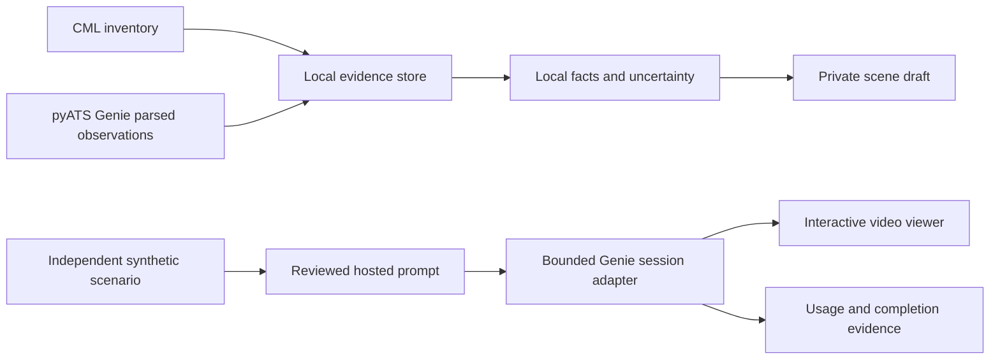

> **Current integration status — 2026-11-23:** 25/30 tasks complete. The owner accepted five recorded illustrations with documented visual/event limits. The existing Border owns an enrolled Genie member; actual Sonnet/skill/MCP/backend fixture execution passes. Four current SSH collector attempts timed out; Google usage remains unavailable with full reservations held. Merge and original Spec198 remain gated. See [integration-closeout.md](integration-closeout.md). All older checkpoints below are historical and do not supersede this status.

# Genie-to-Genie feasibility — 2026-11-22

Sections before “Planning revalidation and decisions” preserve the initial
feasibility record. The later section and plan.md govern the chosen design.

## Finding

A supported programmatic route exists. Google announced Genie4 developer access
on November19,2026, through the Interactions API and AI Studio. Older search
results claiming there is no API predate this announcement. Account access has
not been tested in this session.

Source: [Google's dated API announcement](https://blog.google/innovation-and-ai/technology/developers-tools/genie-4-in-gemini-api/).

## Integration routes

| Route | Evidence and decision |
| --- | --- |
| Official API | Preferred. The documented model is `genie-4`, through `v1beta` Live Interactions. |
| Python / JavaScript | Official SDK examples and a Google cookbook exist. A local compiler can turn selected facts into scene instructions. |
| MCP | No official Genie world-execution MCP was established by this research. A small NetClaw wrapper around the documented API is feasible engineering, not an existing tested integration. |
| Skills | A skill can collect facts, prepare/review the scene and orchestrate a bounded session. It does not grant service access or make model output authoritative. |
| Computer use | Project Genie supports interactive text/image creation, but this session's CUA tool failed with `CUA_REPL_ENABLED_SURFACES is required`. No signed-in page was inspected. |

Google supplies a [documentation MCP and coding-agent guide](https://aistudio.google.com/docs/coding-agents.md).
That is documentation assistance, not a Genie execution server. Many unrelated
products also use the name Genie; a Databricks Genie MCP is not this integration.

## Confirmed technical contract

The [Genie developer guide](https://aistudio.google.com/docs/genie) documents
create → connect → `world_setup` → navigation/text events → completion.
WebRTC is the browser route; Python and Node can use WebSockets. Browser access
uses short-lived session tokens while the API key stays on the backend.
The stream includes generated video and audio. Explicit completion or cancel
ends generation; merely disconnecting is insufficient. The model accepts scene
text, a starting image and movement events, but does not call tools or return
structured network state. It maintains a temporal visual model, not a persistent
scene graph. Account entitlement and actual SDK behavior remain live-test gates.

[Official cookbook](https://github.com/google-gemini/cookbook/blob/main/quickstarts/Get_started_Genie_4.ipynb).
[Model reference](https://aistudio.google.com/docs/models/genie-4).

The [current price table](https://aistudio.google.com/docs/pricing#genie-4)
requires a paid-tier key: $17.50 per million video output tokens, audio included,
approximately US$0.10/second or US$6.05/minute at24fps. Input charges are separate.
A proposed single20second trial is approximately US$2.02 of output; this is an
estimate, not a hard service spending cap or an approved budget. No paid request
was made. A server-owned deadline and explicit terminal receipt are necessary.

## Proposed architecture

For a future authorized data-sharing design, a reviewed projection could connect
the private scene draft to the hosted prompt. That boundary is intentionally
closed here: AGENTS.md keeps private topology/configuration local, and hiding
names or IPs does not remove topology sensitivity.

Possible metaphors: routers as routing halls, switches as distribution rooms,
subnets as neighborhoods, observed links as corridors, and observed state as
colored status lamps. Build connectivity only from actual neighbor evidence;
the current show-version/interface sample proves no inter-device adjacencies.
Illustrative scenery is fictional and must be labeled as such.

Genie could make network walkthroughs, educational scenarios and incident
storytelling engaging. It should not be responsible for exact labels, faithful
topology preservation, path computation or reachability predictions. Keep those
in the deterministic local facts view; CML/pyATS remain the measurement tools.

The [prompt guide](https://deepmind.google/models/genie/prompt-guide/)
recommends clear scene/viewpoint descriptions, checking the preview and issuing
one simple live change at a time. That supports the synthetic prompt below;
it does not prove the model will obey it.

## Live acceptance still needed

1. Establish the owner's paid API access or available authenticated browser.
2. Agree a finite generation allowance for the exact synthetic trial.
3. Generate, navigate, request one fictional change and retain its observed result.
4. End generation explicitly; retain completion/usage evidence or an unknown.
5. Review fidelity before selecting an adapter, MCP surface or product UI scope.

No credentials were found in the two inspected runtime dotenv files. This is not
a claim that the owner has no key elsewhere. An async question requests only
a private local path, never a secret value in chat. No private facts or files
were sent to Google; only public documentation was fetched.

## Planning revalidation and decisions — 2026-11-22

This section supersedes the earlier suggestion that any successful cancel or
browser disconnect establishes termination. Public documentation and pinned SDK
source were read; no provider request was made. Design is complete with live
evidence gates retained. The supplied links suffice; no further links needed.

### R1 — API behind a NetClaw skill and MCP

**Decision:** Official API is the worker backend; skill and six MCP control
tools are the NetClaw interface after the standalone proof. **Rationale:** This
fulfills the user's updated direction and keeps one lifecycle implementation.
**Alternatives:** Browser automation lacks dependable backend lifecycle; Google's
[documentation MCP](https://aistudio.google.com/docs/coding-agents.md) answers
coding questions and is not a world execution server. No unrelated Genie MCP.

### R2 — backend WebSocket and minimal local viewer

**Decision:** One backend session worker receives video; local browser Canvas
shows frames. **Rationale:** The [stream documentation](https://aistudio.google.com/docs/genie#decoding-stream)
defines JPEG video deltas and PCM audio. Existing Node HTTP/ws and browser APIs
suffice.20s target, no audio required. **Alternatives:** WebRTC is recommended
for browsers but complicates independent backend stop; Python notebook adds a
second viewer path; media server/transcoding is unnecessary.

The [model reference](https://aistudio.google.com/docs/models/genie-4) documents
1280×720,16:9,24fps and maximum120s sessions; one optional16:9 image. It supplies
no authoritative network state or durable editable scene graph. Start text-only;
a deterministic local synthetic image can be a later reviewed refinement.

### R3 — pin SDK and disable effect retries

**Decision:** Pin [JavaScript SDK3.6.1](https://github.com/googleapis/js-genai/releases/tag/v3.6.1)
in the worker; repository-supported Node24/26 selection satisfies its Node>=22
requirement. Keep wrapper dependencies separate from its optional MCP peer.
[Package metadata](https://raw.githubusercontent.com/googleapis/js-genai/v3.6.1/package.json).
[Python SDK3.6.1](https://github.com/googleapis/python-genai/releases/tag/v3.6.1)
and the [official notebook](https://github.com/google-gemini/cookbook/blob/main/quickstarts/Get_started_Genie_4.ipynb)
are reference alternatives, not second required runtimes for generation.

Live support is [experimental](https://raw.githubusercontent.com/googleapis/js-genai/v3.6.1/src/_live_interactions_experimental.ts).
Pin lockfile/integrity and retain provider contract fixtures. The
[create implementation](https://raw.githubusercontent.com/googleapis/js-genai/v3.6.1/src/gaos/funcs/interactions-create.ts)
has retry defaults; explicitly use per-request `retries:{strategy:"none"}` and
fault-test actual sends. Never rely solely on an application-level retry flag.

### R4 — termination evidence, not method return

**Decision:** Keep one receiver alive after graceful completion, retain terminal
receipt and usage; unknowns block another attempt. **Rationale:** The pinned
[WebSocket implementation](https://raw.githubusercontent.com/googleapis/js-genai/v3.6.1/src/_interactions_websocket.ts)
resolves `complete()` after sending; `cancel()` flushes and locally closes.
Neither is a server terminal receipt. The
[completion event](https://raw.githubusercontent.com/googleapis/js-genai/v3.6.1/src/gaos/models/interactions/live-interaction-completed-event.ts)
has optional usage, so terminal and cost settlement are separate dimensions.

**Alternatives rejected:** Generic [REST cancel](https://raw.githubusercontent.com/googleapis/js-genai/v3.6.1/src/gaos/funcs/interactions-cancel.ts)
is documented for running background interactions, not established as a live
Genie kill switch. [GET by ID](https://aistudio.google.com/api-reference/interactions-api/get-interaction-by-id)
is a possible reconciliation route whose live behavior must be qualified.
No session resumption assumption. Separate worker survives client/controller
loss but cannot survive its own/host loss by magic; unknown remains unknown.
The dedicated REST-cancel documentation page failed retrieval; pinned source
provided the restriction. No live stop/reconciliation proof exists yet.

### R5 — cost reservation and entitlement

**Decision:** Propose one20s trial with US$15 reservation; paid execution awaits
an exact allowance and entitlement. **Rationale:** The
[price table](https://aistudio.google.com/docs/pricing#genie-4) lists paid-tier
inputUS$1.50/million tokens, text outputUS$9/million and video outputUS$17.50/million,
audio included.240tokens/frame ×24fps ×20s ×17.50/1e6 = US$2.016;
120s = US$12.096, before input/text output. This is planning arithmetic, not a
bill or service-enforced cap. Local deadline is30s from send; reserve the full
service duration in case local control is lost. Refresh prices/bound and margin
before approval; block if exposure cannot be bounded within the allowance.

[Rate limits](https://aistudio.google.com/docs/rate-limits#genie-4) permit varying
account concurrency, but choose one locally. A subscription or key's presence
is not API entitlement. Do not create a paid account. Never reset the ledger or
change IDs to bypass an unresolved spend reservation. No automatic second run.

### R6 — illustration and event fidelity

**Decision:** Four distinct structures,three corridors,one fixed lamp/dimming
message sent once;10s navigation and three review checkpoints. **Rationale:**
Simple metaphors make roles and incident storytelling assessable. Facts/labels
are separate from pixels. **Alternatives:** Exact generated text, simulated
routing,editable meshes and presumed topology consistency have no basis here.

The [API prompting guide](https://aistudio.google.com/docs/genie-prompting)
suggests repeated short event prompts. For the first proof choose one send;
measure failure rather than hide it with replay. Any later bounded repeated
burst is a changed reviewed event policy, with every send recorded and no
resume after uncertainty. The [DeepMind guide](https://deepmind.google/models/genie/prompt-guide/)
supports simple viewpoint/scenery and incremental changes. Neither predicts a
successful network scene. See spec SC-007/008 for the fixed go/no-go rubric.

### R7 — evidence pipeline and local access

**Decision:** Reuse selected isolated pyATS and private testbed, qualify a small
read-only collector; no installation-wide repair. **Rationale:** Fresh planning
checks at16:28:52Z authenticated CML (HTTP200,ready=true,2.10.0+build.13), initialized
native MCP and listedR1/R2. Listing is not device execution. Earlier Nov22 retained
actual parsed `show version` from all four devices,IOS17.18.2. Docker29.9.2 responds.
Isolated Python3.12.12,pyATS/Genie/parser/Unicon25.2 and MCP2.3.0 are present.
Default Node25.3.0 and Python3.14.6 are not the selected qualification runtimes.

Installed parser source supports version,interface brief,LLDP detail and CDP
detail schemas. Actual neighbor reads are unqualified. Version fields are
`version.{version,hostname,platform,os}`; interfaces use
`interface[name].{status,protocol,ip_address}`; LLDP nests
`interfaces[local].port_id[remote].neighbors[id]`; CDP uses `index[n]`.
Keep full parser paths/version in provenance; normalize only known fields.

**Implementation trap:** Existing `pyats_run_show_command` calls parse, then
executes the command again on parsing exception. `retries=1`/pcall do not remove
that read. Qualify capture-once/offline-parse within existing read policy or
state the actual bound honestly. Unicon can also issue an operating-mode probe
with empty init lists. Read transcripts before claiming exact command counts.

**Alternatives:** Default discovery/testbed is known unreliable; repairing all
runtimes or changing SSH pins is out of scope. Four-node BOOTED inventory is
not topology/routing-health evidence. Private raw probe evidence is local under
`.spec200-local/readiness/`; earlier evidence paths remain in verification.md.

### R8 — local-only facts and smallest real NetClaw

**Decision:** Synthetic fixture registry is the only outbound source; private
snapshots/derivatives stay local, including agent context and screenshots.
A fresh local Focused OpenClaw is sufficient for later skill/MCP qualification.
**Rationale:** No topology anonymization claim, cloud/federation dependency or
owner-runtime change is needed. **Alternatives:** Hosted private topology or
adopting an existing home needs different authorization and offers no benefit
to first proof. HUD/VS Code/Mobile changes are deferred with the explicit impact
and coherence gate in plan.md. MemPalace is unavailable; daily log and GAIT
retain this planning record.

### Implementation revalidation — 2026-11-22

The installed official SDK3.6.1 contains automatic continuation in addition to
HTTP retries. Adapter explicitly sets `automatic_continuation:false` and
`retries:{strategy:'none'}`. Intercepted actual SDK503/reset tests each observed
one create send. This is local fault qualification,no Google request.

An active world supports session movement/text controls;no persistent object API
or completed-session resumption is documented. The saved prompt/recording cannot
reopen the same simulation. Existing Cloud CLI login/project were verified;Genie
still requires paid-tier Gemini API access. Current key acquisition guidance is
[AI Studio API keys](https://aistudio.google.com/docs/api-key):import an existing
project,then create its key. No key/billing/project mutation occurred.

## Foundation-first research delta — 2026-11-22 Toronto

Installed official Python MCP2.3.0 uses `mcp.server.mcpserver.MCPServer`, not the
v1 `FastMCP` import. Client models expose snake_case attributes. Actual stdio
calls may return text JSON without structured_content; qualification supports
the observed form. The implementation uses the installed SDK and closed argument
models, not a hand-written JSON-RPC transport. The canonical member spec validates
through existing Spec184 support without adding a new Border or default profile.

Official Google docs were rechecked2026-11-23 00:16UTC. `genie-4` remains a paid
Interactions API model with live keyboard/text steering; no persistent per-device
object API is documented. Reviewed one-attempt cost arithmetic and completion
limits are in [live review](world-suite/LIVE-REVIEW.md). The actual key is present,
but no streaming entitlement or generated-world proof is claimed.

Latest SW1 enrichment connection timed out before any requested command. Preserve
its earlier fully verified baseline and source window beside later R1/R2/SW2
observations. The complete sealed bundle supports offline world work; no further
network access is required to inspect or derive local scene drafts.
