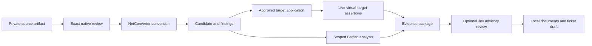

# Review package and communication

Every assertion carries its producer/version, timestamp, artifact hashes, expected
and observed result, evidence class and limitation. Verdicts are passed, failed,
blocked, not_applicable, not_run or unknown. Keep controlled-peer, static-model,
live-virtual and live-device evidence distinct; do not calculate a misleading
single completion percentage from mixed classes.

Use existing draw.io/diagram skills for observed and proposed topology. Label
each view; show source format, conversion job, candidate and adaptation hashes,
target image, interfaces and which tests actually ran. A compact conceptual view:

Consult Jev only when enabled and within its existing budget/disclosure rules.
Provide permitted evidence metadata; keep an unavailable assessment explicit.
Explain whether its advice supported, challenged or changed the recommendation.
Neither confidence nor model agreement clears a blocked finding.

Use existing document/report skills when a shareable document is requested.
Include actual provenance, remaining manual work, unsupported features, failed or
unexecuted assertions, rollback/recovery and retained resources. Draft ServiceNow
or other ticket content locally; creation or sending is a separate authorized
communication. Production deployment retains its approved change workflow.

For the community article, make the achievement concrete: actual conversion job,
target accepted configuration, observed neighbor/route/traffic results, and work
the engineer still reviewed. Keep private addressing/configuration out of public
material. Until the account, image or target test is qualified, label that stage
pending; a staged article is not a published or successful demonstration.
